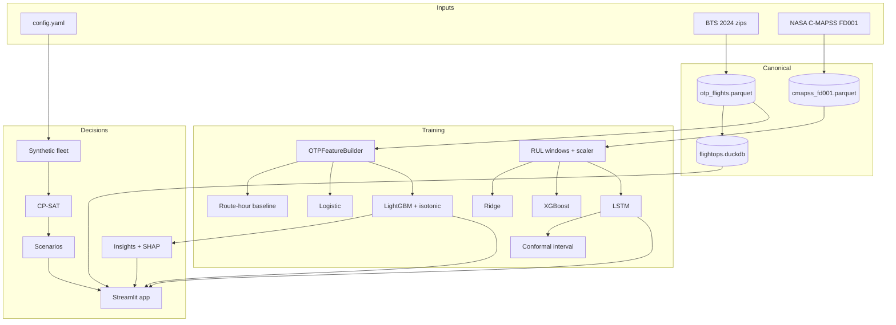

# FlightOps Insight — Technical Documentation

**Version:** 0.1.0 prototype  
**Purpose:** local, end-to-end decision-support prototype for airline Flight
Operations (OTP) and CAMO (engine RUL and maintenance planning)  
**Data:** public BTS 2024 On-Time Performance, NASA C-MAPSS FD001, and a seeded
synthetic maintenance fleet  
**Status:** prototype; not certified, not deployed, not airline-validated

For a hands-on walkthrough, see [TUTORIAL_GUIDE.md](TUTORIAL_GUIDE.md).

---

## 1. System purpose and scope

The system integrates three decision layers that are usually separate:

1. **Predictive (flight operations):** estimate the probability that a flight
   departs more than 15 minutes late, at a documented T-90 minute cutoff.
2. **Predictive (airworthiness):** estimate engine remaining useful life (RUL)
   from the last 30 cycles of sensor data, with uncertainty and an alert policy.
3. **Prescriptive (maintenance):** assign aircraft needing maintenance to hangar
   slots under hard operational constraints, minimising cost.

A Streamlit app presents all three and translates model output into
plain-language recommendations. Every page includes its assumptions and a
"So what / recommended action" box.

### 1.1 What the system achieves

| Area | Achievement | Evidence |
|---|---|---|
| OTP ranking | ROC-AUC 0.818, PR-AUC 0.661, ECE 0.019 on held-out Nov–Dec 2024 | `reports/metrics/otp_metrics.json` |
| OTP targeting | 4.45x top-decile lift; 44.5% of delays captured; 72.5% precision at recommended threshold | `otp_metrics.json` |
| RUL point prediction | XGBoost RMSE 14.0 cycles vs Ridge 21.4 | `reports/metrics/rul_metrics.json` |
| RUL safety policy | 20-cycle alert: 88.2% precision, 93.8% recall, $1.525M vs $4.0M no-alert cost | `rul_metrics.json` |
| RUL uncertainty | 90% conformal interval ±22.6 cycles; 83% empirical coverage | `rul_metrics.json` |
| Maintenance planning | $645k optimized vs $1.198M current practice (46.1% saving), solver-proven OPTIMAL | `reports/optimization/scenario_results.json` |
| Reproducibility | Seeded, time-based and unit-based splits, idempotent artifacts | `config.yaml`, tests |
| Verification | 30 unit tests across data, features, RUL windows, optimizer constraints and live tracking | `tests/` |

### 1.2 Non-goals

- No automated flight cancellation, delay or re-crewing.
- No airworthiness release-to-service authority.
- No airline integration (no Skywise, MRO, OCC, crew, gate or weather feed).
- No claim of causal effects or audited financial savings.
- No production security, SSO, audit trail or drift monitoring.

---

## 2. Architecture

### 2.1 Runtime stages

```
Stage 1  INGEST      BTS zips -> canonical flights Parquet
                     C-MAPSS text -> canonical RUL Parquet
                     Parquet + CSV artifacts -> DuckDB

Stage 2  FEATURES    OTPFeatureBuilder (fit on train, serialise)
                     RUL window builder + scaler (fit on train, serialise)

Stage 3  MODELS      Route-hour baseline, logistic, LightGBM + isotonic
                     Ridge, XGBoost, LSTM + conformal interval

Stage 4  DECIDE      OTP insights + SHAP figures
                     Synthetic fleet + CP-SAT planner + scenarios
                     Streamlit decision app
```

The live tracking page is a separate read-only branch: it calls the OpenSky API
at request time and does not participate in the batch training pipeline.
Everything else is reproducible from local artifacts.

Each stage is independently runnable:

| Stage | Entry point |
|---|---|
| Data | `scripts/build_data.py` |
| OTP | `scripts/train_otp.py` |
| RUL | `scripts/train_rul.py` |
| Optimization | `scripts/run_optimization.py` |
| End to end | `scripts/run_all.py` |
| App | `python -m streamlit run app.py` |

### 2.2 Component map

| Layer | Module | Responsibility |
|---|---|---|
| Configuration | `src/flightops/config.py` | Load YAML, dotted access, paths, seeding, directories |
| I/O | `src/flightops/io.py` | JSON, Parquet, joblib, timer |
| Logging | `src/flightops/logging_utils.py` | Console + file logging |
| Contracts | `src/flightops/data/contracts.py` | Required columns and quality checks |
| Providers | `src/flightops/data/providers.py` | Provider interfaces |
| BTS ingestion | `src/flightops/data/otp.py` | Download, extract, canonical SQL, synthetic fallback |
| Reference data | `src/flightops/data/aircraft.py` | Synthetic type mapping, hubs, holidays |
| C-MAPSS ingestion | `src/flightops/data/rul.py` | Parse, RUL labels, synthetic fallback |
| Storage | `src/flightops/data/database.py` | DuckDB views/tables and named queries |
| OTP features | `src/flightops/features/otp_features.py` | Derived features, splits, encoders, baseline |
| RUL features | `src/flightops/features/rul_features.py` | Sensor selection, windows, scaling, unit split |
| OTP models | `src/flightops/models/otp_model.py` | Train, calibrate, threshold, SHAP, persist |
| OTP serving | `src/flightops/models/otp_predict.py` | Load artifacts, predict, local explanation |
| RUL models | `src/flightops/models/rul_model.py` | Ridge/XGB/LSTM, conformal, alerts, watchlist |
| Evaluation | `src/flightops/models/evaluation.py` | Classification/regression metrics, cost curves |
| Fleet generator | `src/flightops/optimization/synthetic_fleet.py` | Aircraft, slots, due dates, costs |
| Planner | `src/flightops/optimization/maintenance_planner.py` | CP-SAT model, validation, greedy/defer |
| Scenarios | `src/flightops/optimization/scenarios.py` | Baseline, disruptions, sensitivity, exports |
| Analytics | `src/flightops/analysis/otp_insights.py` | EDA figures, segment lift, RCA narrative |
| Live tracking | `src/flightops/live/tracking.py` | OpenSky ADS-B fetch, parsing, filters, demo fallback |
| App shell | `src/flightops/app/app.py` | Navigation |
| App data | `src/flightops/app/data_access.py` | Cached artifact reads and DuckDB queries |
| App pages | `src/flightops/app/pages/*.py` | Six decision pages |

### 2.3 Data flow



---

## 3. Repository layout

```
config.yaml                     Single source of truth for assumptions
pyproject.toml                  Package metadata, pytest and lint config
requirements.txt                Runtime dependencies
app.py                          Streamlit launcher (adds src/ to sys.path)
Makefile / run.ps1              Task shortcuts
src/flightops/
  config.py                     Config wrapper, seeding, paths
  io.py                         Typed I/O helpers
  logging_utils.py              Logging setup
  data/                         Ingestion, contracts, storage, enrichment
  features/                     OTP and RUL feature builders
  models/                       Training, evaluation, serving
  optimization/                 Synthetic fleet, CP-SAT, scenarios
  analysis/                     EDA and RCA
  live/                         OpenSky ADS-B fetch, parsing, filters, demo fallback
  app/                          Streamlit shell, data access, six pages
  sql/                          DuckDB schema and named queries
scripts/                        Reproducible pipeline entry points
tests/                          30 unit tests
docs/                           Architecture, data model, model cards, limitations
deployment/                     Vertex AI and Databricks assets
reports/                        Generated metrics, figures, optimization outputs
artifacts/                      Trained models and encoders
data/                           Raw, extracted and processed data
notebooks/                      OTP EDA, RUL, optimization, R statistics
```

---

## 4. Configuration model

### 4.1 Loading

```python
from flightops.config import load_config, set_global_seed, ensure_directories
cfg = load_config()                 # reads repository config.yaml
cfg.get("otp.prediction_cutoff_min")  # dotted nested access
cfg.path("data.otp.parquet")          # absolute Path
cfg.with_overrides({...})             # deep-merged copy for experiments
```

`Config` is a frozen dataclass wrapping a nested mapping. `path()` resolves
relative paths against the repository root, not the current working directory.

### 4.2 Key configuration groups

| Group | Key examples | Effect |
|---|---|---|
| `project` | `seed: 42`, `name` | Reproducibility and branding |
| `paths` | `data_raw`, `data_processed`, `artifacts`, `reports` | All output locations |
| `data.otp` | `source`, `year`, `months`, `max_rows`, `min_route_hour_flights` | BTS ingestion |
| `data.rul` | `source`, `subset`, `mirror_base` | C-MAPSS ingestion |
| `data.synthetic` | `n_flights`, `n_aircraft`, `start_date`, `horizon_days` | Synthetic fallbacks |
| `split` | `train_months`, `val_months`, `test_months` | Time-based OTP split |
| `otp` | `target`, `prediction_cutoff_min`, `lgbm`, `logistic`, `calibration` | OTP model |
| `otp.threshold_costs` | `false_negative_usd`, `false_positive_usd` | Cost-optimal threshold |
| `otp.business_case` | costs, prevention scenarios, `target_flag_rate` | Financial framing |
| `rul` | `max_rul`, `window`, `val_fraction`, thresholds, costs, LSTM/XGB params | RUL model |
| `optimization` | horizon, fleets, hangars, costs, solver limits, scenarios | CP-SAT instance |
| `app` | `title`, `cache_ttl_seconds`, `max_table_rows` | UI behavior |
| `live_tracking` | `default_region`, `refresh_seconds`, `request_timeout_s`, `allow_demo_fallback`, `max_aircraft_display`, `regions` | OpenSky live map |

### 4.3 Seeding

`set_global_seed()` seeds:

- Python `random`,
- NumPy,
- PyTorch CPU and CUDA,
- `PYTHONHASHSEED`.

The default seed is `project.seed = 42`. The synthetic fleet and RUL split also
use this seed. Aircraft-type assignment is deterministic but intentionally
**independent** of the process seed: it uses an MD5 hash of
`tail_number|carrier`.

---

## 5. Data architecture

### 5.1 BTS ingestion

Source: U.S. Bureau of Transportation Statistics, 2024 monthly PREZIP files.
`data/otp.py` performs:

1. **Download** — one zip per month, validated with `zipfile.is_zipfile`;
   partial downloads use `.zip.part` and then replace.
2. **Extract** — the first CSV member is extracted once to
   `data/raw/extracted/otp_2024_MM.csv`.
3. **Canonical SQL** — DuckDB reads all months with `union_by_name=true`.
4. **Filtering** — invalid clock times and non-positive elapsed times are
   dropped; carriers with fewer than 1,000 flights are removed.
5. **Enrichment** — aircraft type/family/seats/minimum turn, hub flags,
   holiday and weekend flags, route key.
6. **Validation** — `validate_otp` enforces the canonical contract.
7. **Persistence** — Parquet with zstd compression.

The canonical build has **7,079,059 rows and 51 columns**.

### 5.2 Canonical flight schema (selected columns)

| Group | Columns |
|---|---|
| Identity | `flight_date`, `month`, `day_of_week`, `day_of_year`, `carrier`, `tail_number`, `flight_number`, `origin`, `dest`, `route` |
| Schedule | `sched_dep_ts`, `sched_arr_ts`, `actual_dep_ts`, `actual_arr_ts`, `dep_hour`, `dep_minute` |
| Outcomes (not features) | `dep_delay_min`, `dep_del15`, `arr_delay_min`, `arr_del15`, `cancelled`, `diverted` |
| Operational | `distance_mi`, `crs_elapsed_min`, `actual_elapsed_min`, `air_time_min`, `taxi_out_min`, `taxi_in_min` |
| Cause attribution (not features) | `carrier_delay_min`, `weather_delay_min`, `nas_delay_min`, `security_delay_min`, `late_aircraft_delay_min` |
| Aircraft enrichment | `aircraft_type`, `aircraft_family`, `seats`, `min_turn_min` |
| Turnaround | `sched_turn_min`, `prev_dep_delay_min`, `prev_arr_delay_obs`, `inbound_known`, `prev_cancelled` |
| Network | `origin_hour_departures`, `origin_daily_departures`, `route_daily_frequency`, `is_hub_origin`, `is_hub_dest` |
| Calendar | `is_holiday`, `is_weekend` |

### 5.3 The T-90 cutoff

The feature that creates leakage risk is the inbound aircraft's actual delay.
The SQL only exposes it when the previous actual arrival is at least
`prediction_cutoff_min` (default 90) before this scheduled departure:

```sql
CASE
  WHEN prev_dest = origin
   AND prev_actual_arr_ts IS NOT NULL
   AND prev_actual_arr_ts <= sched_dep_ts - (90 * INTERVAL 1 MINUTE)
  THEN prev_arr_delay_min
END AS prev_arr_delay_obs
```

`inbound_known` is set by the same condition. At serving time, if the inbound
aircraft has not arrived by the cutoff, the predictor sends a missing inbound
delay and `inbound_known = 0`.

### 5.4 Synthetic aircraft enrichment

BTS has no equipment field. `data/aircraft.py`:

- holds approximate 2024 carrier fleet mixes,
- maps `(tail_number, carrier)` deterministically to a type via MD5,
- derives family, seats and minimum turnaround,
- supplies carrier-hub sets and 2024 holiday windows.

This enrichment is **explicitly synthetic** and must be replaced by a real fleet
registry in production.

### 5.5 C-MAPSS ingestion

`data/rul.py`:

- reads whitespace-separated text with 26 columns,
- computes training RUL as `max_cycle(unit) - cycle`,
- computes test RUL as `published_last_rul + (last_observed_cycle - cycle)`,
- validates 26 columns and 100 test rows,
- writes `data/processed/cmapss_fd001.parquet` (33,727 rows, 28 columns).

### 5.6 Data contracts

`data/contracts.py` defines immutable dataclasses with required columns and
quality checks. Key checks:

- required columns present,
- non-empty frame (unless `allow_empty`),
- no null `flight_date`,
- `dep_del15 ∈ {0,1}`,
- `cancelled ∈ {0,1}`,
- no null RUL `unit`,
- RUL `cycle >= 1`.

The contract is the replacement seam for an airline data feed.

### 5.7 DuckDB analytics layer

`data/database.py` creates:

- a `flights` view over the OTP Parquet,
- dimension views: `dim_date`, `dim_carrier`, `dim_airport`, `dim_aircraft`,
  `dim_route`,
- summary tables: `otp_overview`, `otp_daily`, `otp_monthly`, `otp_hour`,
  `otp_carrier`, `otp_aircraft`, `otp_route`, `turnaround_effect`,
  `delay_cause_mix`,
- artifact views when available: `fleet_watchlist`, `maintenance_plan`.

Named queries in `sql/queries.sql` are loaded by the `-- name:` marker and used
by the app and insights builder. DuckDB is opened read-only by the app.

---

## 6. OTP delay-risk pipeline

### 6.1 Split and eligibility

Split by calendar month:

| Split | Months | Rows (reference) |
|---|---|---:|
| Train | Jan–Aug 2024 | 4,621,706 |
| Validation | Sep–Oct 2024 | 1,186,776 |
| Test | Nov–Dec 2024 | 1,156,765 |

Eligibility: `cancelled = 0`, `diverted = 0`, non-null `dep_del15` and
`dep_delay_min`. The test period is strictly later than validation, and
validation is later than training.

### 6.2 Feature vector

**28 numeric features:**

```
month, day_of_week, day_of_year, dep_hour, dep_minute,
is_weekend, is_holiday, distance_mi, crs_elapsed_min, seats,
min_turn_min, sched_turn_min, turnaround_buffer_min,
prev_dep_delay_min, prev_arr_delay_obs, inbound_known,
has_turnaround, prev_cancelled, origin_hour_departures,
origin_daily_departures, route_daily_frequency,
is_hub_origin, is_hub_dest, is_peak, hour_sin, hour_cos,
doy_sin, doy_cos
```

**9 categorical features:**

```
carrier, origin, dest, route, aircraft_type, aircraft_family,
origin_state, dest_state, dep_time_block
```

`OTPFeatureBuilder`:

- fits category vocabularies on training only,
- keeps an explicit `__UNKNOWN__` level,
- coerces numeric columns to float64,
- maps unseen categories to `__UNKNOWN__`,
- serialises to JSON so train and serve share exactly one contract.

### 6.3 Leakage controls

1. Time-based split only; no random row split.
2. Post-flight delay-cause fields are never in the feature list.
3. Actual delay and target are never in the feature list.
4. Inbound actuals are gated by `inbound_known` at T-90.
5. Route-hour rates, encoders, LightGBM and calibrators are fitted without test
   months.
6. Isotonic calibration uses validation only.
7. Test metrics are computed once after all choices are frozen.

### 6.4 Models

#### Route-hour baseline

Smoothed historical delay rate by `(route, hour)`:

```
rate = (delayed + 25 × global_rate) / (flights + 25)
```

If a route-hour has fewer than `min_route_hour_flights` (30), it falls back to
the route rate, then to the global rate. This is a transparent operational rule,
not ML.

#### Logistic regression

- median numeric imputation,
- one-hot encoding with `handle_unknown="ignore"` and `min_frequency=100`,
- `C=0.5`, `saga`, `max_iter=1000`,
- trained on at most 750,000 rows for prototype speed.

#### LightGBM

| Parameter | Value |
|---|---|
| Objective | binary |
| Metric | AUC |
| Boosting | GBDT |
| Learning rate | 0.05 |
| Max leaves | 127 |
| Min data in leaf | 150 |
| Feature fraction | 0.85 |
| Bagging fraction / freq | 0.9 / 1 |
| L2 | 1.0 |
| Max trees | 600 |
| Early stopping | 50 rounds |
| Best iteration (reference) | 177 |

### 6.5 Calibration and threshold policy

**Calibration.** A separate isotonic regressor is fitted per probabilistic model
on validation predictions. The route-hour baseline always uses isotonic; the
logistic and LightGBM models use the configured method (`isotonic` by default).
Probabilities are clipped to `[1e-5, 1 - 1e-5]`.

**Threshold selection.** The cost table on validation uses:

```
total_cost(t) = FN(t) × $4,500 + FP(t) × $250
```

The minimum-cost threshold is **0.05** in the reference run, but it flags about
842k validation flights and is not operationally usable. The project therefore
also computes the validation top-decile threshold:

```
t* = quantile(validation_probabilities, 1 - target_flag_rate)
   = 0.3031 for target_flag_rate = 0.10
```

The app uses `operating_threshold.recommended`, which is the top-decile
threshold. Both values remain in `otp_metrics.json` for transparency.

### 6.6 Evaluation results (held-out Nov–Dec 2024)

| Metric | Route-hour | Logistic | LightGBM |
|---|---:|---:|---:|
| ROC-AUC | 0.6246 | 0.7471 | **0.8182** |
| PR-AUC | 0.2493 | 0.5226 | **0.6610** |
| Brier | 0.1451 | 0.1165 | **0.0965** |
| ECE | 0.0376 | 0.0420 | **0.0189** |
| Precision @0.5 | 0.000 | 0.7990 | 0.8532 |
| Recall @0.5 | 0.000 | 0.2805 | 0.4054 |
| Top-decile precision | 0.2899 | 0.6794 | **0.8014** |
| Top-decile lift | 1.61x | 3.77x | **4.45x** |
| Top-decile capture | 16.1% | 37.7% | **44.5%** |

At the recommended threshold (0.3031):

| Metric | Value |
|---|---:|
| Flagged flights | 141,762 |
| Flag rate | 12.26% |
| Precision | 72.53% |
| Recall | 49.31% |
| Average delay among flagged true positives | 81.4 min |

Business case scenario (planning assumptions, not causal):

- $85/min delay cost + $1,200 re-accommodation ⇒ $8,123 per delay,
- $250 intervention per flagged flight,
- 10% prevention assumption ⇒ $83.5M gross avoided, $35.4M intervention,
  **$48.1M net**, ROI 1.36.

### 6.7 Explainability

- `shap.TreeExplainer` on the LightGBM booster,
- reproducible 6,000-row sample from the test period,
- global bar and beeswarm figures,
- `otp_shap_importance.csv` with mean absolute SHAP per feature,
- grouped importance for executives.

Reference grouped importance:

| Group | Share of total mean absolute SHAP |
|---|---:|
| Turnaround & inbound aircraft | 55.6% |
| Airport & network | 15.0% |
| Time of day | 11.9% |
| Season & calendar | 11.1% |
| Carrier | 4.5% |
| Aircraft & route | 2.0% |

Top individual features: inbound departure delay, scheduled turnaround, inbound
arrival delay, hour sine, day-of-year cosine, carrier, route, origin.

These are **associational** contributions, not causal effects.

### 6.8 Serving

`otp_predict.OTPPredictor`:

- loads the serialised builder, booster and calibrator,
- transforms a single row with the same feature contract,
- predicts raw probability and applies calibration,
- explains a row with local SHAP values,
- maps probability to tiers:
  - ≥ 0.75 Critical,
  - ≥ 0.50 High,
  - ≥ 0.25 Moderate,
  - otherwise Low.

---

## 7. RUL pipeline

### 7.1 Data and split

- C-MAPSS FD001: one operating condition, one fault mode.
- 100 training engines (run to failure).
- 100 official test engines (truncated, published ground truth).
- Training engines split 80/20 by unit: 80 train, 20 validation.
- The 100 test engines are untouched until final evaluation.

### 7.2 Sensor selection

Starting from 21 sensors, constant channels are dropped (`std <= 1e-6`). The
reference build keeps **15 sensors**:

```
sensor_2, 3, 4, 6, 7, 8, 9, 11, 12, 13, 14, 15, 17, 20, 21
```

Dropped as constant:

```
sensor_1, 5, 10, 16, 18, 19
```

### 7.3 Windowing

- window = 30 cycles,
- target = `min(RUL, 125)` for training,
- one window per valid end cycle (stride 1),
- test engines scored once at their last window,
- no window crosses an engine-unit boundary,
- scaler fitted on training only, persisted as JSON.

### 7.4 Models

| Model | Input | Configuration |
|---|---|---|
| Ridge | Last scaled sensor snapshot | `alpha=1.0` |
| XGBoost | 30-cycle summary statistics: last, mean, std, min, max, slope per sensor | 500 trees max, depth 4, LR 0.04, early stopping 50 |
| LSTM | Raw scaled 30×15 sequence | 2 layers, hidden 64, dropout 0.2, Adam LR 1e-3, weight decay 1e-5, batch 128, max 80 epochs, patience 12 |

XGBoost best iteration: 135. LSTM early-stopped at epoch 17 in the reference run.

### 7.5 Conformal interval

Split-conformal calibration on all validation windows:

```
q = quantile(|y_val - pred_val|, 1 - alpha),  alpha = 0.10
interval = [pred - q, pred + q]
```

Reference:

- `q = 22.572` cycles,
- nominal coverage 90%,
- empirical test coverage **83%**,
- interpretation: interval is slightly narrow on 100 test engines.

### 7.6 Alert policy and cost model

Safety event: `true RUL <= critical_cycles` (20).

At each predicted-RUL threshold `t`:

- `pred_alarm = pred_rul <= t`,
- TP = predicted alarm and event,
- FP = predicted alarm, no event,
- FN = no alarm, event,
- `cost = (TP + FP) × early_cost + FN × unscheduled_cost`.

Reference costs:

- unscheduled removal: **$250,000**,
- planned early removal: **$75,000**.

Reference results:

| Threshold | TP | FP | FN | TN | Precision | Recall | Cost |
|---:|---:|---:|---:|---:|---:|---:|---:|
| 19 (cost-optimal) | 15 | 2 | 1 | 82 | 88.24% | 93.75% | $1.525M |
| **20 (selected)** | **15** | **2** | **1** | **82** | **88.24%** | **93.75%** | **$1.525M** |

Benchmarks:

- no alerts: $4.0M (16 missed events × $250k),
- remove all engines early: $7.5M (100 × $75k),
- selected policy: $1.525M,
- savings vs no alerts: **$2.475M**,
- savings vs remove-all: **$5.975M**.

Cost sensitivity (±50% on both costs) keeps the optimal threshold at 19 cycles.

### 7.7 Risk tiers and watchlist

| Tier | Predicted RUL | Recommended action |
|---|---|---|
| Critical — remove now | ≤ 10 | Ground aircraft / remove engine; complete engineering review |
| High — schedule shop visit | ≤ 20 | Reserve a shop slot within 7 days; increase borescope monitoring |
| Watch — plan next visit | ≤ 40 | Plan next shop visit; re-score weekly |
| Serviceable | > 40 | Continue service; re-score at next check |

Reference watchlist distribution: 72 Serviceable, 11 Watch, 8 High, 9 Critical.

The watchlist uses LSTM predictions because the alert policy is evaluated on
them. XGBoost is kept as the best point predictor and Ridge as a transparent
baseline.

### 7.8 RUL evaluation results

| Metric | Ridge | XGBoost | LSTM |
|---|---:|---:|---:|
| RMSE (cycles) | 21.360 | **13.999** | 15.366 |
| MAE (cycles) | 17.132 | **10.448** | 11.549 |
| R² | 0.7358 | **0.8865** | 0.8633 |
| NASA score (mean) | 10.692 | **2.860** | 3.602 |
| Late-prediction rate | 56% | 61% | **46%** |
| P90 absolute error | 35.478 | **23.535** | 25.301 |

The asymmetric NASA/PHM score penalises late predictions more than early ones,
because late RUL estimates are the safety-relevant failure mode.

---

## 8. Maintenance optimization

### 8.1 Synthetic instance generation

`build_instance(cfg, scenario)`:

- 30 synthetic aircraft are generated across A320 (12), B737 (10), E190 (8),
- only aircraft with `due_day <= horizon - 1` enter the instance
  (15 aircraft in the reference build),
- 14-day horizon starting 2026-11-09,
- 52 slots:
  - 14 A-check slots per hangar × 3 hangars = 42,
  - 5 two-day C-check slots in H1 and H2 = 10.

Due-date logic per aircraft:

```
a_due      = floor((A_interval − hours_since_A) / daily_flight_hours)
c_due      = floor((C_interval − hours_since_C) / daily_flight_hours)
engine_due = floor((engine_RUL − 5) / daily_cycles)
due_day    = min(a_due, c_due, engine_due)
```

The binding driver is recorded. If C-interval or engine RUL binds, the required
check type is C; otherwise A.

### 8.2 Mathematical model

Sets:

- `A` — aircraft needing maintenance inside the horizon,
- `S` — hangar slots,
- `D` — hangar-days.

Variables:

- `x[a,s] ∈ {0,1}` — aircraft `a` assigned to slot `s`,
- `u[a] ∈ {0,1}` — aircraft `a` left unassigned.

Constraints:

```
(1) sum_s x[a,s] + u[a] = 1                    for all a
(2) sum_{a,s: day ∈ s} x[a,s] <= 1             for all hangar-days
(3) x[a,s] = 0  if fleet/check/ground-time incompatible
(4) x[a,s] = 0  outside the horizon
```

Objective:

```
minimise  sum_{a,s} c[a,s] x[a,s] + sum_a c_unassigned[a] u[a]
```

### 8.3 Cost function

For an eligible aircraft-slot pair:

```
disruption_days = 0.5 for A-check, 2.0 for C-check
ferry           = 5000 if aircraft.base != slot.base else 0
disruption      = disruption_days × 18000 + ferry

early_days      = max(0, due_day - slot.start_day)
late_days       = max(0, slot.start_day - due_day)

early_waste     = early_days × 2500
aog_risk        = 30000 × late_days × (late_days + 1) / 2
total           = disruption + early_waste + aog_risk
```

Unassigned cost:

```
days_late   = max(0, horizon - max(due_day, 0))
disruption  = 2.0 × 18000
aog_risk    = 30000 × days_late × (days_late + 1) / 2
total       = 400000 + disruption + aog_risk
```

The AOG penalty is quadratic in lateness, but it is **pre-computed per pair**, so
the CP-SAT model remains linear.

> Documentation note: `docs/model_cards/optimization_model_card.md` states a
> $12,000 ferry cost. The implementation uses **$5,000**
> (`synthetic_fleet.py`). Treat the code as the source of truth.

### 8.4 Solver, validation and fallback

- Solver: OR-Tools CP-SAT.
- Time limit: 20 s; workers: 8; seed 42.
- Every pair cost is rounded to an integer for the objective.
- After solving, `validate_plan` checks:
  - every aircraft is assigned or explicitly unassigned,
  - no unknown aircraft/slot,
  - every assignment is eligible,
  - no slot is double-booked,
  - no assignment is outside the horizon.
- If the solver returns neither `OPTIMAL` nor `FEASIBLE`, the code logs a
  warning and falls back to the greedy earliest-feasible-slot plan.

### 8.5 Baselines and scenarios

Baselines:

- **Defer all** — no maintenance; exposes unassigned and AOG cost.
- **Current practice** — greedy earliest feasible slot, sorted by due date.
- **CP-SAT optimized** — the proposed plan.

Disruption scenarios:

| Scenario | Perturbation |
|---|---|
| `hangar_closure` | Remove `H3` (configured) |
| `rul_stress` | Reduce engine RUL by 25% |
| `demand_surge` | Increase daily flight hours and cycles by 10% |

Sensitivity:

- AOG penalty varied over `[15k, 22.5k, 30k, 45k, 60k]`,
- each value re-solves the baseline instance,
- results show the trade-off between flying disruption and AOG exposure.

### 8.6 Reference results

| Plan | Cost | Assigned | Unassigned | Status |
|---|---:|---:|---:|---|
| Defer all | $19.62M | 0 | 15 | DEFER_ALL |
| Current practice | $1.1975M | 14 | 1 | GREEDY |
| CP-SAT optimized | **$645,000** | **15** | **0** | **OPTIMAL** |

Savings vs current practice: **$552,500 (46.14%)**. Solve time: 0.033 s.

Cost breakdown:

| Component | Optimized | Greedy |
|---|---:|---:|
| Disruption | $430,000 | $435,000 |
| Early maintenance | $35,000 | $152,500 |
| AOG risk | $180,000 | $210,000 |
| Unassigned penalty | $0 | $400,000 |

Scenario results:

| Scenario | Optimized cost | Unassigned | Greedy cost | Savings vs greedy |
|---|---:|---:|---:|---:|
| Hangar H3 closure | $657,500 | 0 | $1,187,500 | $530,000 |
| RUL stress (−25%) | $3,641,500 | 3 | $3,744,000 | $102,500 |
| Demand surge (+10%) | $785,500 | 0 | $940,500 | $155,000 |

RUL stress is the binding constraint.

---

## 9. Application

### 9.1 Page map

| Page | Route | Reads | Main interaction |
|---|---|---|---|
| OTP overview | `otp-overview` | `otp_metrics.json`, `otp_insights.json`, DuckDB | Carrier/month filters, EDA tabs |
| Live flight tracking | `live-traffic` | OpenSky ADS-B API at runtime | Region/movement/altitude/callsign filters, map and detail |
| Delay-risk predictor | `delay-risk` | OTP artifacts | Score one flight, local SHAP, sensitivity |
| Fleet health & RUL | `fleet-health` | `rul_metrics.json`, watchlist, alert costs, C-MAPSS Parquet | Filter tiers, drill into engine |
| Maintenance optimizer | `maintenance-plan` | `scenario_results.json`, plans, instance | Inspect schedule and cost |
| Scenario comparison | `scenarios` | `scenario_results.json`, sensitivity | Compare disruptions and policy |

### 9.2 Data access and caching

`app/data_access.py`:

- `@st.cache_data(ttl=600)` for JSON, CSV and DuckDB queries,
- `@st.cache_resource` for the config singleton,
- pagination/row limits from `app.max_table_rows`,
- read-only DuckDB connections.

`app/common.py`:

- CSS injection,
- page header,
- "So what" recommendation box,
- assumption box,
- money and percentage formatting,
- missing-artifact guard with a copyable command.

### 9.3 Failure behavior

If an artifact is missing, the page does not crash. It shows:

```
<Artifact> is not available yet.
<command to generate it>
```

The predictor guards model loading in a `try/except` and shows an error if the
artifact cannot be loaded.

---

## 10. Live flight tracking

### 10.1 Purpose and data source

The live tracking page answers a different question from the batch pipeline:
*where is traffic right now?* It is a read-only runtime feature and is not part
of the BTS/C-MAPSS training path.

Source: **OpenSky Network**, a crowd-sourced ADS-B network exposing a public
REST endpoint:

```
GET https://opensky-network.org/api/states/all
```

Optional query parameters define a rectangular window:
`lamin`, `lomin`, `lamax`, `lomax` (decimal degrees). The module omits them for
the `Global` region.

Authentication:

| Mode | How | Limit |
|---|---|---|
| Anonymous | No credentials | Heavily rate limited (roughly 100 calls/day per IP in the public tier) |
| OAuth2 token | `OPENSKY_ACCESS_TOKEN` | Higher limit |
| OAuth2 client credentials | `OPENSKY_CLIENT_ID` + `OPENSKY_CLIENT_SECRET` | Higher limit; exchanged at the OpenSky Keycloak token endpoint |

Credentials are read from the environment only. They are never written to the
repository or displayed in the app.

### 10.2 State-vector mapping

OpenSky returns one array per aircraft. Some deployments omit the trailing
`category`, so the parser pads short vectors with `None` and drops any state
without a latitude/longitude.

| API index | Raw field | App column | Conversion |
|---:|---|---|---|
| 0 | `icao24` | `icao24` | lower-case string |
| 1 | `callsign` | `callsign` | trimmed string |
| 2 | `origin_country` | `origin_country` | string |
| 3 | `time_position` | `time_position` | Unix seconds |
| 4 | `last_contact` | `last_contact` | Unix seconds → `last_contact_utc` |
| 5 | `longitude` | `longitude` | degrees |
| 6 | `latitude` | `latitude` | degrees |
| 7 | `baro_altitude` | `baro_altitude_m` | metres → `altitude_ft` |
| 8 | `on_ground` | `on_ground` | boolean |
| 9 | `velocity` | `velocity_ms` | m/s → `speed_kt` |
| 10 | `true_track` | `true_track_deg` | degrees |
| 11 | `vertical_rate` | `vertical_rate_ms` | m/s → `vertical_rate_fpm` |
| 12 | `sensors` | `sensors` | passthrough |
| 13 | `geo_altitude` | `geo_altitude_m` | metres → `geo_altitude_ft` |
| 14 | `squawk` | `squawk` | string |
| 15 | `spi` | `spi` | boolean |
| 16 | `position_source` | `position_source` | passthrough |
| 17 | `category` | `category` | nullable numeric |

Derived columns:

- `flight` — callsign, or ICAO24 when the callsign is empty;
- `phase` — `On ground`, `Climbing` (> +300 ft/min), `Descending`
  (< −300 ft/min) or `Level`;
- `position_age_s` — seconds between `last_contact` and the snapshot time;
- `is_demo` — true only for the deterministic fallback.

The frame is sorted airborne-first by descending altitude so the highest
aircraft appear at the top of the table.

### 10.3 Processing pipeline

```
fetch_states(region)          HTTPS GET + optional bearer token
        ↓
parse_states(payload)         pad vectors → coerce types → drop missing positions
        ↓                    convert units → derive flight/phase/age
filter_states(frame, ...)     country, ground/airborne, altitude band, text search
        ↓
summarise_states(filtered)    counts, averages, climb/descent counts
        ↓
page rendering                KPI row → map → charts → table → detail panel
```

`load_tracking(region, ...)` wraps fetch + parse and records metadata:

```python
{
  "source": "OpenSky Network" | "Demo fallback",
  "fetched_at": "<ISO-8601 UTC>",
  "region": {"name": "India", "lamin": 6.0, ...},
  "error": None | "<reason>",
}
```

The page renders this metadata verbatim, so the operator always knows whether
they are looking at live or demo data.

### 10.4 Module surface

`src/flightops/live/tracking.py`:

| Function / object | Responsibility |
|---|---|
| `Region` | Frozen dataclass for a query window |
| `DEFAULT_REGIONS` | India, United States, Europe, Global |
| `region_catalog(cfg)` | Merge `live_tracking.regions` from config over defaults |
| `get_region(name, custom, catalog)` | Resolve a region name, including `Custom` |
| `access_token_from_env()` | Read `OPENSKY_ACCESS_TOKEN` |
| `fetch_client_credentials_token(...)` | Exchange client credentials for a token |
| `resolve_access_token()` | Prefer an explicit token, else cached client-credentials token, else anonymous |
| `fetch_states(region, timeout, token)` | Call OpenSky and return the JSON payload |
| `parse_states(payload)` | Normalise and enrich state vectors |
| `filter_states(frame, ...)` | Apply UI filters |
| `summarise_states(frame)` | Build the KPI dictionary |
| `demo_states(region, n, seed)` | Deterministic, labelled demo snapshot |
| `load_tracking(region, ...)` | Fetch with demo fallback and metadata |
| `empty_states()` | Empty frame with the full schema |

`src/flightops/app/pages/live_tracking.py` owns only presentation and Streamlit
state. `_snapshot` is cached with `@st.cache_data(ttl=30)`; a monotonically
increasing `live_nonce` in session state invalidates the cache when the operator
presses **Refresh now**.

### 10.5 Rate limits, caching and refresh

- Anonymous OpenSky calls are rate limited. The page defaults auto-refresh
  **off** so opening it does not burn the quota.
- The optional auto-refresh uses `st.fragment(run_every=60)`, configurable via
  `live_tracking.refresh_seconds`.
- The snapshot cache TTL is 30 seconds, shorter than the refresh interval, so
  each auto-refresh performs a real fetch.
- A failed request never crashes the page. It returns either an empty frame or
  the labelled demo snapshot, depending on `allow_demo_fallback`.
- For production, use an authenticated, contracted ADS-B feed with an SLA rather
  than the public API.

### 10.6 Demo fallback

`demo_states` generates aircraft inside the selected region using
`numpy.random.default_rng(seed)`. It produces plausible callsigns, countries,
altitudes, speeds and vertical rates, then runs them through the same
`parse_states` path so the schema is identical. Every row is flagged
`is_demo = True`, and `load_tracking` sets `source = "Demo fallback"` and
records the request error. The page shows a warning banner; demo data is never
presented as live.

### 10.7 Page behaviour

Sidebar:

- region selector (configured regions, `Global`, or custom bounds);
- movement filter (all / airborne / on ground);
- altitude band (0–45,000 ft);
- country of origin;
- callsign or ICAO24 substring search;
- demo fallback and auto-refresh toggles;
- **Refresh now**.

Main area:

- KPI row: aircraft in view, airborne/on-ground split, countries, average
  altitude and average speed, plus how many aircraft the filters hide;
- scatter map coloured by phase, sized by altitude, using
  `plotly.express.scatter_map` with `map_style="open-street-map"` and a
  `scatter_geo` fallback if map tiles are unavailable;
- phase-mix bar chart and airborne altitude histogram;
- capped, sortable aircraft table (`live_tracking.max_aircraft_display`);
- aircraft detail panel with altitude, speed, vertical rate, heading, squawk,
  position age and a local `st.map` marker.

Plotly 7 removed `px.scatter_mapbox`; the implementation uses
`px.scatter_map`. Streamlit's `st.map` is used only for the single-aircraft
detail marker.

### 10.8 Limitations

- Crowd-sourced ADS-B coverage is uneven, especially over oceans and remote
  regions.
- Positions can lag by seconds to minutes; the page shows the position age.
- Barometric altitude is not corrected to a local altimeter setting.
- Callsigns may be missing or duplicated; ICAO24 is the stable identifier.
- The public API has no SLA and is rate limited.
- Live tracking is **situational awareness only**. It must not be used for
  separation, dispatch, collision avoidance or any safety-critical decision.

### 10.9 Tests

`tests/test_live_tracking.py` adds 13 tests:

- unit conversion (metres → feet, m/s → knots and ft/min);
- phase assignment for climbing, descending and on-ground states;
- short vectors and states without a position;
- empty payload schema;
- combined country / movement / altitude / search filters;
- KPI summary on populated and empty frames;
- deterministic demo data inside the region bounds;
- custom and unknown region resolution;
- config-driven region overrides;
- live payload success, demo fallback and demo-disabled failure paths.

---

## 11. Testing and quality gates

### 11.1 Test suite

`pytest` is configured in `pyproject.toml`:

```toml
[tool.pytest.ini_options]
testpaths = ["tests"]
addopts = "-q"
pythonpath = ["src"]
```

Run:

```powershell
python -m pytest -v
```

Current result: **30 passed**.

### 11.2 Test matrix

| File | Tests | Coverage |
|---|---:|---|
| `test_data_contracts.py` | 3 | Deterministic aircraft mapping; synthetic OTP contract; synthetic RUL contract and sorted cycles |
| `test_features.py` | 4 | Derived-feature consistency; unseen-category mapping; disjoint time split; baseline fallback on unseen routes |
| `test_optimization.py` | 6 | Assignment completeness; hangar capacity; fleet/check eligibility; greedy vs defer sanity; one row per aircraft; hangar closure reduces slots |
| `test_rul_features.py` | 4 | Window shape and target alignment; last-window mode; train-only scaling; unit-disjoint split |
| `test_live_tracking.py` | 13 | OpenSky unit conversion and phase; short/missing vectors; filters; summaries; deterministic demo data; region catalog; token resolution; live/demo/failure paths |

### 11.3 What is not covered

- No end-to-end model-quality regression test.
- No app UI test (only an HTTP smoke test can be done manually).
- No data-drift test.
- No performance benchmark.
- No property-based tests.

For production, add CI, integration tests, shadow-mode evaluation and a model
quality gate against a frozen reference metric set.

---

## 12. Reproducibility

| Mechanism | Implementation |
|---|---|
| Global seed | `project.seed = 42`, applied to Python, NumPy, PyTorch |
| Synthetic fleet | `numpy.random.default_rng(seed)` |
| OTP split | Calendar months from `config.yaml` |
| RUL split | Deterministic unit shuffle with the same seed |
| Encoders | Fitted on training only, serialised to JSON |
| Calibration | Fitted on validation only |
| Artifacts | Idempotent; reused unless `--force` |
| Figures/metrics | Regenerated from artifacts, never hand-written |
| Aircraft types | MD5 of tail+carrier, independent of process state |

One caveat: PyTorch CPU kernels and LightGBM threading can produce tiny
numerical differences across hardware. The reference metrics in this repository
were produced on the documented environment.

---

## 13. Performance

Reference timings on the development machine:

| Task | Time |
|---|---:|
| OTP training (7.1M rows, 600 max trees) | ~6 minutes |
| RUL training (100 engines, LSTM) | ~35 seconds |
| Optimization (15 aircraft, 52 slots, 3 scenarios + sensitivity) | <1 second |
| `run_all.py --skip-data --skip-train` | 3–5 seconds |
| `pytest` | ~1–2 seconds |
| App startup | a few seconds |

Bottlenecks:

- BTS CSV → DuckDB → Parquet is I/O and CPU heavy.
- LightGBM with 127 leaves and 4.6M training rows dominates OTP training.
- SHAP TreeExplainer on 6,000 rows adds noticeable time.
- The LSTM is small; CPU is sufficient.

---

## 14. Security, limitations and governance

### 14.1 Security

- No credentials in the repository.
- Public data only; no PII.
- App has no authentication or authorization.
- Local DuckDB and local files for the batch pages.
- The live tracking page makes read-only HTTPS calls to OpenSky, optionally
  with a bearer token from the environment. No credentials are stored in the
  repository or exposed in the UI.
- Production requires SSO, RBAC, secret management, audit logs and data
  classification.

### 14.2 Limitations

**OTP**

- Observational associations, not causal effects.
- No weather, crew, gate, rotation or passenger-connection data.
- Aircraft type is synthetic.
- U.S. domestic only.
- Single test season (Nov–Dec 2024).
- Threshold is a capacity policy, not a universal optimum.
- Cost-optimal threshold flags too many flights to be operationally usable.

**RUL**

- Simulated degradation; one fault mode.
- 100 test engines ⇒ wide metric uncertainty.
- RUL cap at 125 compresses early-life labels.
- Conformal coverage 83% vs 90% target.
- No per-prediction sensor attribution.
- Low RUL does not mean "unsafe now"; engineering judgement is mandatory.

**Optimization**

- Synthetic fleet, slots and costs.
- Deterministic durations; no parts, labour, tools or shift constraints.
- No task-level precedence inside a check.
- No rolling-horizon freezing or disruption re-optimization.
- AOG penalty is a policy choice, not a safety case.
- The optimizer may exploit cost assumptions in ways a planner would reject.

**Live tracking**

- Crowd-sourced ADS-B coverage is uneven and can lag.
- The public OpenSky API is rate limited and has no SLA.
- Barometric altitude is not corrected to a local altimeter setting.
- Callsigns may be missing or duplicated; ICAO24 is the stable key.
- The demo fallback is synthetic and is always labelled.
- Not surveillance-grade; never use for separation, dispatch or collision
  avoidance.

### 14.3 Human-in-the-loop

- OTP predictions rank flights; they do not make decisions.
- RUL predictions are a watchlist; a licensed engineer approves removals,
  deferrals and releases.
- The optimizer proposes a plan; CAMO planners approve or override.
- Overrides should be logged with reasons for model monitoring.

---

## 15. Production mapping

The prototype is intentionally split so each stage can be replaced by a managed
service:

| Prototype | Production target |
|---|---|
| `data/otp.py` + Parquet | Databricks ingestion + Unity Catalog + Delta Lake |
| Feature builders | Databricks/Spark feature pipelines with a feature store |
| LightGBM/XGBoost/LSTM training | Vertex AI Pipelines + Model Registry |
| Batch scoring | Vertex AI Batch Prediction or Databricks Jobs |
| Online OTP scoring | Vertex AI Endpoint, p95 < 300 ms target |
| OpenSky live feed | Contracted ADS-B/surveillance feed with an SLA and authentication |
| Streamlit app | Containerized internal app behind SSO |
| CP-SAT planner | OR-Tools service or a managed optimization engine |
| Metrics/figures | Experiment tracking + BI dashboards |
| Config | Versioned config + environment-specific overrides |
| Logs | Central logging, audit trail, alerting |
| Monitoring | Drift, calibration, data quality, alert/override rates |

Recommended production controls:

- model registry approvals and lineage,
- shadow mode for at least one seasonal cycle,
- canary rollout and rollback,
- immutable decision audit trail,
- data contracts and freshness checks,
- fairness and model-risk review where applicable,
- licensed engineer sign-off for maintenance actions.

See [production_mapping.md](production_mapping.md) for the component-by-component
mapping.

---

## 16. Extension points

### 16.1 Replace BTS with an airline feed

1. Implement a provider that emits `OTP_REQUIRED_COLUMNS`.
2. Keep the same canonical column names and time semantics.
3. Enforce the T-90 observability rule in the feed or in `data/otp.py`.
4. Point `data.otp.parquet` at the new output.
5. Re-run `train_otp.py --force`.

Downstream feature and model code does not change.

### 16.2 Replace synthetic aircraft types

Replace `data/aircraft.py` with a registry lookup keyed by tail number. Keep the
output columns (`aircraft_type`, `aircraft_family`, `seats`, `min_turn_min`) and
the hub flags.

### 16.3 Add a new OTP feature

1. Add it to `NUMERIC_FEATURES` or `CATEGORICAL_FEATURES`.
2. Compute it in `add_derived_features` or the ingestion SQL.
3. Ensure it is observable at T-90.
4. Retrain and re-check calibration and top-decile metrics.
5. Update the model card and `docs/data_model.md`.

### 16.4 Add a new RUL model

1. Build sequences with `build_sequence_dataset`.
2. Train on the unit-disjoint split.
3. Evaluate with `regression_metrics`.
4. Add it to `models` in `train_rul_models`.
5. Persist artifacts and update `load_rul_artifacts` and the app watchlist source.

### 16.5 Change optimizer constraints

1. Add the constraint to `solve_maintenance_plan`.
2. Add a matching check to `validate_plan`.
3. Add a unit test in `tests/test_optimization.py`.
4. Update `docs/optimization_model.md` and the model card.

### 16.6 Add a new app page

1. Create `src/flightops/app/pages/<name>.py` with `render()`.
2. Register it in `app.py` with a title, icon and URL path.
3. Read only generated artifacts through `data_access.py`.
4. End the page with a `so_what()` recommendation.

---

## 17. Known documentation inconsistencies

These are minor but worth knowing when reading the repository:

| Item | Documentation says | Code / artifacts say |
|---|---|---|
| Ferry cost | Model card: $12,000 | `synthetic_fleet.py`: $5,000 |
| Constant RUL sensors | Model card text: 7 | Metrics: 6 dropped (`sensor_1,5,10,16,18,19`) |
| App RUL hint | `run_all.py --only-rul` | `run_all.py` has no such flag; use `scripts/train_rul.py` |
| OTP calibration option | `config.yaml` supports `sigmoid`/`none` | Baseline calibrator is always isotonic by design |

The code and generated JSON are the source of truth for results.

---

## 18. Glossary

| Term | Meaning |
|---|---|
| **AOG** | Aircraft on Ground — an unscheduled, costly grounding |
| **A-check** | Light maintenance check, modelled as a one-day overnight slot |
| **C-check** | Heavy maintenance check, modelled as a two-day hangar block |
| **CAMO** | Continuing Airworthiness Management Organisation |
| **CP-SAT** | Google OR-Tools constraint programming satisfiability solver |
| **ECE** | Expected Calibration Error |
| **LightGBM** | Gradient-boosted decision tree library |
| **MRO** | Maintenance, Repair and Overhaul |
| **OCC** | Operations Control Centre |
| **OTP** | On-Time Performance |
| **PR-AUC** | Area under the precision-recall curve |
| **RUL** | Remaining Useful Life |
| **SHAP** | SHapley Additive exPlanations |
| **T-90** | Prediction is made 90 minutes before scheduled departure |
| **Top-decile lift** | Precision in the highest-risk 10% divided by the base delay rate |

---

## 19. Document index

- [Architecture](architecture.md)
- [Data model and contracts](data_model.md)
- [Optimization formulation](optimization_model.md)
- [OTP model card](model_cards/otp_model_card.md)
- [RUL model card](model_cards/rul_model_card.md)
- [Optimization model card](model_cards/optimization_model_card.md)
- [Limitations](limitations.md)
- [Production mapping](production_mapping.md)
- [Executive summary](executive_summary.md)
- [Tutorial guide](TUTORIAL_GUIDE.md)
- [Root-cause summary](root_cause_summary.md)
