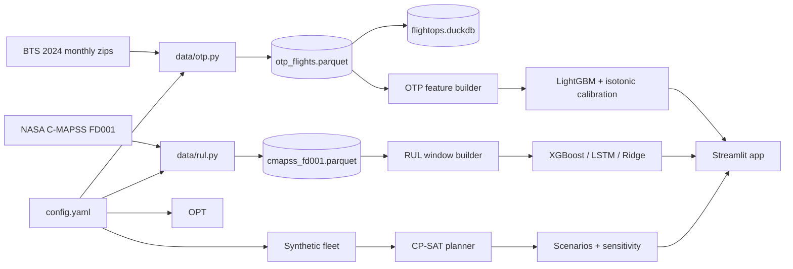

# FlightOps Insight — Step-by-Step Tutorial Guide

This guide explains **what the project is for**, **how it works end to end**, and
**how to run, inspect and extend it** on a local machine.

For the deeper design and algorithm reference, see
[TECHNICAL_DOCUMENTATION.md](TECHNICAL_DOCUMENTATION.md).

---

## 1. What this project achieves

FlightOps Insight is a **decision-support prototype** for airline Flight Operations
and Continuing Airworthiness Management (CAMO). It answers three practical
questions:

| Question | Module | Output |
|---|---|---|
| Which flights are likely to depart more than 15 minutes late? | OTP delay-risk model | Calibrated probability, risk tier, SHAP drivers, recommended action |
| Which engines need attention soon? | RUL model | Predicted remaining cycles, 90% interval, risk tier, watchlist action |
| Which aircraft should go to which hangar slot? | CP-SAT optimizer | Cost-minimising maintenance schedule, cost breakdown, scenario comparison |
| Where is traffic right now? | OpenSky live tracker | Live ADS-B map, filters, aircraft table and detail panel |

A Streamlit app ties these together in six pages and ends each page with a
plain-language recommendation.

**It is not** an airline system, a safety authority, or a certified production
service. Every result is a prototype on public data and stated planning
assumptions. See [limitations.md](limitations.md).

### Success criteria used in the project

- **OTP:** beat simple and logistic baselines on a strictly later time period;
  produce calibrated probabilities and a usable top-decile targeting list.
- **RUL:** beat a last-cycle baseline, report uncertainty with a conformal
  interval, and translate predictions into an economic alert policy.
- **Optimization:** produce a solver-proven feasible plan that respects hangar
  capacity, fleet eligibility, check type, ground time and the planning horizon.
- **Engineering:** no target leakage, no random time splits, reproducible seeds,
  and unit tests for the riskiest logic.

---

## 2. Mental model: one repository, four stages

```
Stage 1  INGEST    BTS zips + NASA C-MAPSS      -> canonical Parquet + DuckDB
Stage 2  FEATURES  leakage-safe feature builders -> model-ready matrices
Stage 3  MODELS    train / calibrate / evaluate  -> artifacts + metrics
Stage 4  DECIDE    CP-SAT plan + insights + app  -> recommendations
```

Everything is driven by `config.yaml`. Code does not hard-code costs, thresholds,
split months or paths.

The live tracking page is a separate read-only branch: it calls the OpenSky API
when the app requests a snapshot and does not participate in the batch pipeline
or the reproducibility guarantees of the trained models.

### 2.1 High-level data flow



### 2.2 Where each output lands

| Output | Path |
|---|---|
| Canonical flight table | `data/processed/otp_flights.parquet` |
| Canonical RUL table | `data/processed/cmapss_fd001.parquet` |
| SQL analytics database | `data/processed/flightops.duckdb` |
| Trained models | `artifacts/models/` |
| Encoders / feature vocabularies | `artifacts/encoders/` |
| Metrics, watchlist, predictions | `reports/metrics/` |
| Figures | `reports/figures/` |
| Maintenance plans and scenarios | `reports/optimization/` |
| Human-readable docs | `docs/` |

---

## 3. Prerequisites

| Requirement | Notes |
|---|---|
| Python 3.11+ | The reference environment used Python 3.12 |
| ~2 GB disk | Raw BTS zips, extracted CSVs, processed Parquet and models |
| Windows / Linux / macOS | Commands below show PowerShell; the Python commands are identical elsewhere |
| Internet | Downloads BTS monthly zips and C-MAPSS if raw files are absent; also required by the live tracking page (OpenSky API) |

Optional, only for extras:

- R 4.x + `rmarkdown`/`knitr`/`survival` + Pandoc for the statistical notebook.
- Jupyter for the analysis notebooks.

---

## 4. Ten-minute quick start (artifacts already present)

If the repository already contains `data/processed`, `artifacts` and `reports`:

```powershell
# 1. Enter the repository
cd "D:\project learning"

# 2. (Recommended) create and activate a virtual environment
python -m venv .venv
.\.venv\Scripts\Activate.ps1
python -m pip install -r requirements.txt

# 3. Run the full test suite
python -m pytest -v

# 4. Rebuild analytics and optimization without retraining
python scripts/run_all.py --skip-data --skip-train

# 5. Launch the app
python -m streamlit run app.py
```

Open <http://localhost:8501>.

Expected test result for the current repository state:

```
30 passed
```

---

## 5. Full tutorial from a clean checkout

### Step 1 — Create the environment

```powershell
python -m venv .venv
.\.venv\Scripts\Activate.ps1
python -m pip install --upgrade pip
python -m pip install -r requirements.txt
```

Verify the core libraries:

```powershell
python -c "import pandas, numpy, sklearn, lightgbm, xgboost, ortools, torch, shap, streamlit; print('OK')"
```

### Step 2 — Build the datasets

```powershell
python scripts/build_data.py
```

What happens:

1. `data/otp.py` looks for `data/raw/bts_2024_MM.zip`. If missing, it downloads
   the public BTS monthly zip and extracts one CSV per month.
2. DuckDB reads all monthly CSVs and applies the canonical SQL transform:
   - types and column names,
   - scheduled/actual timestamps,
   - previous-leg lookup by tail number,
   - scheduled turnaround,
   - **T-90 inbound observability (`inbound_known`)**,
   - airport-hour/day congestion counts.
3. Synthetic aircraft attributes and hub flags are merged in.
4. `validate_otp` enforces the data contract.
5. The result is written to `data/processed/otp_flights.parquet` (~332 MB).
6. C-MAPSS files are parsed, RUL is computed, and
   `data/processed/cmapss_fd001.parquet` is written.
7. `flightops.duckdb` is built with views and pre-aggregated analytics tables.

Useful flags:

```powershell
python scripts/build_data.py --force          # rebuild even if files exist
python scripts/build_data.py --skip-otp       # leave BTS untouched
python scripts/build_data.py --skip-rul       # leave C-MAPSS untouched
```

### Step 3 — Train the OTP delay-risk model

```powershell
python scripts/train_otp.py
```

What happens:

1. Load the canonical flights and add derived features.
2. Split by **month**, never randomly:
   - train = Jan–Aug,
   - validation = Sep–Oct,
   - test = Nov–Dec.
3. Fit the feature vocabulary on training rows only.
4. Fit three models:
   - transparent route-hour smoothed baseline,
   - logistic regression,
   - LightGBM with early stopping.
5. Fit isotonic calibrators on **validation only**.
6. Select two thresholds on validation:
   - cost-optimal threshold (reported for transparency),
   - top-decile threshold (recommended for a finite OCC team).
7. Evaluate once on the held-out test months.
8. Compute global and local SHAP explanations.
9. Save models, encoders, metrics, figures and test predictions.
10. Rebuild `otp_insights.json` and the plain-language root-cause summary.

Use `--force` to retrain even when artifacts exist. Expect roughly **6 minutes**
on the full 7.1M-row BTS dataset.

### Step 4 — Train the RUL models

```powershell
python scripts/train_rul.py
```

What happens:

1. Load C-MAPSS FD001.
2. Keep the 15 informative sensors; drop constant channels.
3. Split the 100 training engines **by unit** into 80 train / 20 validation.
4. Build 30-cycle windows and cap the target at 125 cycles.
5. Train:
   - Ridge on the last sensor snapshot,
   - XGBoost on window summary statistics,
   - an LSTM on the raw scaled sequence.
6. Fit a split-conformal interval on validation residuals.
7. Evaluate once on the official 100 test engines.
8. Build the alert cost table, sensitivity table and watchlist.
9. Save models, scaler, metrics and figures.

Expect roughly **35 seconds** on CPU for the reference run.

### Step 5 — Run the maintenance optimizer

```powershell
python scripts/run_optimization.py
```

What happens:

1. Generate a reproducible synthetic fleet from `project.seed`.
2. Compute each aircraft's next due date from A-check interval, C-check
   interval and engine RUL, then keep the binding driver.
3. Generate hangar slots for a 14-day horizon.
4. Solve three plans:
   - defer all (benchmark),
   - current practice: earliest feasible slot (greedy),
   - CP-SAT optimized.
5. Validate the optimized plan against the same hard constraints.
6. Run disruption scenarios: hangar closure, RUL stress, demand surge.
7. Run AOG-penalty sensitivity.
8. Write plans, figures and `scenario_results.json`.

Expect **under 1 second** for this instance.

### Step 6 — Build optional analysis extracts

```powershell
python scripts/export_analysis_tables.py
```

This writes compact CSVs used by the R notebook and lightweight analyses:
`r_otp_hourly.csv`, `r_otp_daily.csv`, `r_otp_monthly.csv`,
`r_otp_turnaround.csv`, `r_otp_inbound.csv`, `r_rul_survival.csv`.

### Step 7 — Launch the app

```powershell
python -m streamlit run app.py
```

Open <http://localhost:8501>. The app is read-only against generated artifacts;
it never retrains or modifies data.

### Step 8 — Run everything with one command

```powershell
python scripts/run_all.py --force
```

Or the common reuse variants:

```powershell
# Refresh analytics + optimization without retraining
python scripts/run_all.py --skip-data --skip-train

# Reuse data and models, re-solve optimization only
python scripts/run_all.py --skip-data --skip-train --force

# Skip only the RUL training stage
python scripts/run_all.py --force --skip-rul

# Skip optimization
python scripts/run_all.py --skip-data --skip-train --skip-optimize
```

> Note: `run_all.py` does not define a `--only-rul` flag. Use
> `python scripts/train_rul.py` for a RUL-only rebuild.

---

## 6. Step-by-step: how the project works internally

This section follows the path a row of data takes through the system.

### Stage 0 — Configuration and reproducibility

Files: `config.yaml`, `src/flightops/config.py`

`config.yaml` owns:

- the random seed (42),
- input/output paths,
- split months,
- model hyper-parameters,
- thresholds and cost assumptions,
- fleet and hangar definitions,
- scenario perturbations.

`load_config()` returns a typed wrapper with dotted access:

```python
from flightops.config import load_config
cfg = load_config()
print(cfg.get("otp.prediction_cutoff_min"))   # 90
print(cfg.path("data.otp.parquet"))           # absolute path
```

`set_global_seed()` seeds Python, NumPy and PyTorch. `ensure_directories()`
creates every output directory.

### Stage 1 — Ingest BTS flights

File: `src/flightops/data/otp.py`

The key SQL logic:

1. Read all monthly CSVs with DuckDB.
2. Convert BTS HHMM clock values into minutes and timestamps.
3. Handle a scheduled arrival that crosses midnight.
4. Order each tail number's legs by scheduled departure.
5. Compute previous-leg context:
   - `sched_turn_min` when the previous arrival airport equals this origin,
   - `prev_arr_delay_obs` only if the previous actual arrival was observable
     at least 90 minutes before this scheduled departure,
   - `inbound_known` as the explicit observability flag,
   - previous cancellation flag.
6. Compute congestion counts:
   - departures at origin in the same hour,
   - departures at origin that day,
   - route frequency that day.
7. Attach synthetic aircraft attributes and holiday/weekend flags.
8. Drop tiny carriers (< 1,000 flights) to stabilise categorical splits.
9. Validate the contract and write Parquet.

**Why the T-90 rule matters.** If the model used the inbound aircraft's actual
arrival unconditionally, it would use information that is not available at
decision time. `inbound_known` encodes the cutoff in the data, not just in a
comment.

### Stage 2 — Data contracts

File: `src/flightops/data/contracts.py`

Every provider must emit the required columns. The contract checks:

- required columns exist,
- the frame is non-empty (unless explicitly allowed),
- `flight_date` has no nulls,
- `dep_del15` and `cancelled` are binary,
- RUL `unit` is non-null and `cycle >= 1`.

This is the seam that allows a real airline/Skywise export to replace BTS
without rewriting downstream code.

### Stage 3 — OTP feature engineering and splits

File: `src/flightops/features/otp_features.py`

Derived features:

- `route = origin + "_" + dest`,
- departure time block,
- peak indicator (15:00–20:00),
- turnaround buffer = scheduled turn − minimum turn,
- has-turnaround flag,
- clipped inbound delay values,
- cyclical hour and day-of-year encodings.

The model uses **37 features**:

- 28 numeric,
- 9 categorical.

The fitted `OTPFeatureBuilder`:

- learns the category vocabulary from training rows,
- maps unseen categories to `__UNKNOWN__`,
- serialises to `artifacts/encoders/otp_feature_builder.json`,
- is reused by training, batch scoring and the app to prevent train/serve skew.

Time split:

```python
train = months 1-8
val   = months 9-10
test  = months 11-12
```

Only completed flights with a valid target are model-eligible.

### Stage 4 — OTP model training, calibration and thresholding

File: `src/flightops/models/otp_model.py`

Models:

| Model | Role | Notes |
|---|---|---|
| Route-hour smoothed rate | Transparent baseline | Fallback from route-hour → route → global |
| Logistic regression | Interpretable baseline | 750k-row subsample, one-hot encoding |
| LightGBM | Main model | Early stopping on validation AUC |

Calibration:

- isotonic regression fitted on validation predictions,
- input probabilities clipped to avoid log/0 issues,
- calibrator saved as a joblib artifact.

Threshold selection:

- evaluate business cost on **validation**:
  `cost = FN × $4,500 + FP × $250`,
- report the cost-optimal threshold (0.05),
- also compute the validation top-decile threshold (0.3031),
- use the top-decile threshold as the app's recommended operating point.

Evaluation metrics on held-out Nov–Dec:

| Metric | Route-hour | Logistic | LightGBM |
|---|---:|---:|---:|
| ROC-AUC | 0.6246 | 0.7471 | **0.8182** |
| PR-AUC | 0.2493 | 0.5226 | **0.6610** |
| Brier | 0.1451 | 0.1165 | **0.0965** |
| ECE | 0.0376 | 0.0420 | **0.0189** |
| Top-decile lift | 1.61x | 3.77x | **4.45x** |

At the recommended threshold:

- 12.2% of test flights flagged,
- 72.5% precision,
- 49.3% recall,
- 81.4 average delay minutes among flagged true positives.

Explainability:

- global SHAP bar and beeswarm plots,
- grouped importance (turnaround & inbound ≈ 56%),
- local SHAP contributions in the predictor page.

### Stage 5 — RUL data, windows and models

Files: `data/rul.py`, `features/rul_features.py`, `models/rul_model.py`

Data:

- NASA C-MAPSS FD001,
- 100 run-to-failure training engines,
- 100 truncated test engines with published ground truth,
- 26 raw columns: unit, cycle, 3 settings, 21 sensors.

Windowing:

- 30-cycle rolling window,
- target capped at 125 cycles,
- 15 informative sensors after dropping constant channels,
- scaling statistics fitted on training only.

Splits:

- 80 training engines / 20 validation engines, by unit,
- 100 official test engines scored once at their last window.

Models:

| Model | Input | Role |
|---|---|---|
| Ridge | Last sensor snapshot | Classical baseline |
| XGBoost | Window summary statistics | Strong tabular model |
| LSTM | Raw 30-cycle sequence | Sequence model |

Uncertainty:

- split-conformal interval from validation residuals,
- target 90% coverage,
- measured interval ±22.6 cycles,
- empirical test coverage 83%.

Alert policy:

- safety event: true RUL ≤ 20 cycles,
- compare planned early removal ($75k) with unscheduled removal ($250k),
- selected threshold 20 cycles → precision 88.2%, recall 93.8%,
- cost-optimal threshold 19 cycles gives the same confusion matrix,
- no-alert cost $4.0M, remove-all cost $7.5M, selected policy $1.525M.

The app's watchlist uses LSTM predictions because the alert policy is evaluated
on them. XGBoost remains the best point predictor on this split (RMSE 14.0).

### Stage 6 — Synthetic maintenance instance

File: `src/flightops/optimization/synthetic_fleet.py`

For each synthetic aircraft:

- draw hours since A-check,
- draw hours since C-check,
- draw engine RUL,
- compute due days:
  - `a_due = (A interval − hours since A) / daily flight hours`,
  - `c_due = (C interval − hours since C) / daily flight hours`,
  - `engine_due = (engine RUL − margin) / daily cycles`,
- keep the earliest as `due_day` and record the `binding_driver`,
- choose check type:
  - A-check unless C-interval or engine RUL is binding.

Slots:

- 14-day horizon,
- one A-check slot per hangar per day,
- C-check slots every 3 days for C-capable hangars,
- each slot carries hangar, base, duration, ground time and eligible fleets.

Only aircraft whose due date falls inside the horizon are included.

### Stage 7 — CP-SAT maintenance optimization

File: `src/flightops/optimization/maintenance_planner.py`

Decision variables:

- `x[a,s] = 1` if aircraft `a` is assigned to slot `s`,
- `u[a] = 1` if aircraft `a` is left unassigned.

Constraints:

1. Each aircraft is assigned exactly once or explicitly deferred:
   `sum_s x[a,s] + u[a] = 1`.
2. At most one aircraft per hangar-day.
3. Only eligible aircraft-slot pairs create variables (fleet, check type,
   ground time).
4. Only slots inside the horizon are used.

Objective:

```
minimise  sum c[a,s] · x[a,s] + sum c_unassigned[a] · u[a]
```

Cost components per pair:

- flying disruption (lost margin + ferry),
- early-maintenance waste (`early_days × $2,500`),
- escalating AOG risk (`penalty × late_days × (late_days + 1) / 2`),
- unassigned penalty (`$400,000` + disruption + AOG exposure).

The plan is validated after solving. If the solver fails, the code falls back to
the greedy plan.

Reference result:

| Plan | Cost | Assigned | Unassigned |
|---|---:|---:|---:|
| Defer all | $19.62M | 0 | 15 |
| Earliest feasible (current practice) | $1.198M | 14 | 1 |
| CP-SAT optimized | **$645k** | **15** | **0** |

Savings: **$552.5k (46.1%)**, solver status **OPTIMAL** in 0.033 s.

### Stage 8 — Insights, figures and the app

File: `src/flightops/analysis/otp_insights.py`

- runs named DuckDB queries,
- writes monthly/hourly/carrier/aircraft/turnaround/route/cause figures,
- builds `otp_segment_lift.csv`,
- writes an associational root-cause narrative to
  `reports/metrics/otp_insights.json` and `docs/root_cause_summary.md`.

App files:

- `src/flightops/app/app.py` — navigation and page registration,
- `common.py` — styling, decision boxes, formatting,
- `data_access.py` — cached reads of JSON/CSV and DuckDB queries,
- `src/flightops/live/tracking.py` — OpenSky fetch, parsing, filters and demo fallback,
- `pages/` — six pages.

The app reads only generated artifacts. If an artifact is missing, the page
shows a warning and the command needed to create it.

---

## 7. Using the app page by page

### Page 1 — OTP overview

- KPI row: flights, OTP rate, delay rate, average delay, cancellations.
- Filters: carrier and month.
- Tabs:
  - network and time-of-day charts,
  - turnaround/root-cause charts and SHAP,
  - model metrics, calibration/ROC/PR figures, financial framing.
- Ends with a "So what" recommendation.

### Page 2 — Live flight tracking

- Calls the public OpenSky Network ADS-B API for the selected region.
- Sidebar controls:
  - region (India, United States, Europe, Global or custom bounds),
  - movement filter (all, airborne, on ground),
  - altitude band,
  - country of origin,
  - callsign or ICAO24 search,
  - optional auto-refresh (60 s) and a manual refresh button.
- Main area:
  - KPI row: aircraft in view, airborne/on-ground, countries, average altitude
    and average speed,
  - coloured map by flight phase (climbing, descending, level, on ground),
  - phase-mix and altitude-distribution charts,
  - sortable aircraft table,
  - aircraft detail panel with altitude, speed, vertical rate, heading and
    last position age.
- If OpenSky is unreachable, the page shows a clearly labelled **demo snapshot**
  when the fallback is enabled. It never pretends the demo data is live.

### Page 3 — Delay-risk predictor

- Enter carrier, route, aircraft type, date/time, turnaround, distance, block
  time, inbound status and congestion counts.
- The model scores at the documented T-90 cutoff.
- Shows:
  - probability gauge and risk tier,
  - top local SHAP drivers,
  - primary driver and recommended action,
  - sensitivity to inbound delay vs scheduled turnaround.

### Page 4 — Fleet health & RUL

- KPI row: engines scored, critical/high counts, LSTM RMSE, asymmetric score.
- Predicted RUL distribution and predicted-vs-true scatter.
- Alert economics and conformal coverage.
- Filterable watchlist with recommended actions.
- Engine drill-down with sensor trajectory.

### Page 5 — Maintenance optimizer

- KPI row: aircraft to schedule, slots, optimized cost, savings, solver time.
- Gantt-style hangar timeline.
- Auditable assignment table.
- Cost breakdown and explanation of why the optimizer wins.

### Page 6 — Scenario comparison

- Disruption stress tests: hangar closure, RUL stress, demand surge.
- Optimized vs current-practice cost chart.
- Scenario table and AOG-penalty sensitivity curve.

---

## 8. Experiment recipes

### 8.1 Change the prediction cutoff

Edit `config.yaml`:

```yaml
otp:
  prediction_cutoff_min: 120
```

Then rebuild the OTP data and retrain:

```powershell
python scripts/build_data.py --force --skip-rul
python scripts/train_otp.py --force
```

The cutoff affects `inbound_known` and `prev_arr_delay_obs` in the canonical
data, so a feature-only retrain is not enough.

### 8.2 Change the operating threshold policy

Edit `config.yaml`:

```yaml
otp:
  business_case:
    target_flag_rate: 0.05     # top 5% instead of top 10%
  threshold_costs:
    false_negative_usd: 6000
    false_positive_usd: 200
```

Retrain OTP. The app reads the newly persisted recommended threshold.

### 8.3 Change the RUL alert policy

```yaml
rul:
  alert_threshold_cycles: 15
  critical_threshold_cycles: 8
  watch_threshold_cycles: 35
  cost:
    unscheduled_removal_usd: 300000
    early_removal_usd: 90000
```

Retrain RUL. The watchlist tiers and cost table are regenerated.

### 8.4 Stress the maintenance instance

```yaml
optimization:
  horizon_days: 21
  scenarios:
    hangar_closure: "H2"
    rul_stress_pct: 0.40
    demand_surge_pct: 0.20
  aog_risk_penalty_usd_per_day: 45000
```

Re-run:

```powershell
python scripts/run_optimization.py --force
```

### 8.5 Run offline with synthetic data

```yaml
data:
  otp:
    source: "synthetic"
  rul:
    source: "synthetic"
```

This is a smoke-test fallback with the same schema. It is **not** used for the
reported metrics.

### 8.6 Configure live flight tracking

Edit `config.yaml`:

```yaml
live_tracking:
  default_region: "India"
  refresh_seconds: 60
  request_timeout_s: 20
  allow_demo_fallback: true
  max_aircraft_display: 1500
  regions:
    India: {lamin: 6.0, lomin: 68.0, lamax: 36.0, lomax: 98.0}
    United States: {lamin: 24.0, lomin: -125.0, lamax: 50.0, lomax: -66.0}
    Europe: {lamin: 35.0, lomin: -12.0, lamax: 72.0, lomax: 45.0}
```

- `default_region` must be a key under `regions`, `Global`, or `Custom`.
- `refresh_seconds` controls the optional auto-refresh interval.
- `allow_demo_fallback` decides whether the page may show labelled demo data.
- `max_aircraft_display` caps the table rows for responsiveness.

For higher OpenSky rate limits, set OAuth credentials in the environment before
starting the app:

```powershell
$env:OPENSKY_CLIENT_ID = "your-client-id"
$env:OPENSKY_CLIENT_SECRET = "your-client-secret"
# or provide an already-issued token
$env:OPENSKY_ACCESS_TOKEN = "your-access-token"
python -m streamlit run app.py
```

Anonymous access is heavily rate limited and is intended only for demos.

---

## 9. Testing guide

Run everything:

```powershell
python -m pytest -v
```

Run one file:

```powershell
python -m pytest tests/test_optimization.py -v
```

Run one test:

```powershell
python -m pytest tests/test_features.py::test_builder_maps_unseen_category_to_unknown -v
```

### What the 30 tests cover

| File | Tests | What is protected |
|---|---:|---|
| `test_data_contracts.py` | 3 | Deterministic aircraft mapping; synthetic OTP/RUL providers satisfy contracts |
| `test_features.py` | 4 | Derived features; unseen-category handling; disjoint time splits; baseline fallback |
| `test_optimization.py` | 6 | One assignment per aircraft; hangar capacity; fleet/check compatibility; greedy vs defer; one row per aircraft; hangar closure reduces slots |
| `test_rul_features.py` | 4 | Window shape/alignment; last-window mode; train-only scaling; unit-disjoint split |
| `test_live_tracking.py` | 13 | OpenSky unit conversion and phase; short/missing vectors; filters; summaries; deterministic demo data; region catalog; token resolution; demo/live fallbacks |

### Recommended quality gate before sharing results

```powershell
python -m pytest -q
python scripts/run_all.py --skip-data --skip-train
python -m streamlit run app.py
```

Then check:

- `reports/metrics/otp_metrics.json` and `rul_metrics.json` exist,
- `reports/optimization/scenario_results.json` exists,
- the app health endpoint returns 200:
  `Invoke-WebRequest http://localhost:8501/_stcore/health`.

---

## 10. Troubleshooting

| Symptom | Likely cause | Fix |
|---|---|---|
| `ModuleNotFoundError: flightops` | Running Python without `src` on the path | Use the provided scripts or `python -m pytest`; or install with `pip install -e .` |
| Streamlit starts but pages show "not available" | Artifacts missing | Run `python scripts/run_all.py --skip-data` or the specific training script |
| BTS download fails | Network/proxy/URL changed | Place monthly zips in `data/raw/`; or switch `data.otp.source` to `synthetic` for a smoke test |
| OTP training is slow | Full 7.1M rows | Lower `data.otp.max_rows`, or reuse existing artifacts without `--force` |
| RUL training cannot find C-MAPSS | Raw files missing and mirror unavailable | Put `train_FD001.txt`, `test_FD001.txt`, `RUL_FD001.txt` in `data/raw/` |
| App port already in use | Another Streamlit process | `python -m streamlit run app.py --server.port 8502` |
| Live map is empty or shows HTTP 429 | OpenSky rate limit, no aircraft in bounds, or a network/proxy issue | Wait a minute, widen the region, enable the demo fallback, or set `OPENSKY_ACCESS_TOKEN` |
| Live tracking shows "Demo fallback" | OpenSky was unreachable or rate limited | Check the warning banner; the data is synthetic and labelled |
| PowerShell shows `NativeCommandError` around logs | Logs go to stderr; PowerShell treats that as an error | Check `$LASTEXITCODE`; the pipeline can still exit 0 |
| Optimization results do not change | Existing JSON is reused | Add `--force` |

---

## 11. Command cheat sheet

```powershell
# Environment
python -m venv .venv
.\.venv\Scripts\Activate.ps1
python -m pip install -r requirements.txt

# Data
python scripts/build_data.py
python scripts/build_data.py --force

# Models
python scripts/train_otp.py
python scripts/train_rul.py
python scripts/train_otp.py --force
python scripts/train_rul.py --force

# Optimization
python scripts/run_optimization.py
python scripts/run_optimization.py --force

# Everything
python scripts/run_all.py --force
python scripts/run_all.py --skip-data --skip-train

# Optional analysis
python scripts/export_analysis_tables.py
python scripts/make_notebooks.py
python scripts/build_executive_summary.py

# App
python -m streamlit run app.py

# Tests
python -m pytest -v
```

The same tasks are available through `run.ps1` and the `Makefile`:

```powershell
.\run.ps1 data
.\run.ps1 train-otp
.\run.ps1 train-rul
.\run.ps1 optimize
.\run.ps1 all
.\run.ps1 app
.\run.ps1 test
```

---

## 12. What to inspect first

If you are reviewing the project for the first time, read in this order:

1. `README.md` — headline results and honest reading.
2. `config.yaml` — every assumption in one place.
3. `docs/architecture.md` — stages and components.
4. `docs/data_model.md` — schema and leakage rules.
5. `src/flightops/data/otp.py` — the canonical SQL transform.
6. `src/flightops/features/otp_features.py` — the feature contract.
7. `src/flightops/models/otp_model.py` — training, calibration, thresholds.
8. `src/flightops/models/rul_model.py` — windows, conformal interval, alert cost.
9. `src/flightops/optimization/maintenance_planner.py` — CP-SAT model.
10. `src/flightops/live/tracking.py` — live ADS-B fetch, parsing and demo fallback.
11. `src/flightops/app/` — how results become recommendations.
12. `tests/` — what the project considers non-negotiable.

---

## 13. Expected runtime and outputs

| Task | Reference runtime | Main outputs |
|---|---:|---|
| `build_data.py` (cached raw) | several minutes; dominated by BTS CSV → Parquet | 2 Parquet files + DuckDB |
| `train_otp.py` | ~6 minutes | models, calibrators, metrics, figures, predictions |
| `train_rul.py` | ~35 seconds | LSTM/XGB/Ridge, scaler, metrics, watchlist |
| `run_optimization.py` | <1 second | plans, scenarios, sensitivity, figures |
| `run_all.py --skip-data --skip-train` | a few seconds | refreshed insights + optimization |
| `pytest` | ~1–2 seconds | 30 passing tests |
| Streamlit app | starts in a few seconds | six-page decision app |
| Live tracking page | ~1–20 seconds per snapshot | map, KPI row, table and demo fallback |

---

## 14. Next steps

- Replace BTS with an approved airline data contract.
- Replace synthetic aircraft types with a real fleet registry.
- Join weather, ATC, crew, gate and rotation feeds.
- Backtest on the airline's own history and run shadow mode.
- Add drift and calibration monitoring.
- Add authentication, audit trails and human override logging.
- Have licensed engineers and CAMO approve any maintenance use.

The technical details behind these steps are in
[TECHNICAL_DOCUMENTATION.md](TECHNICAL_DOCUMENTATION.md).
