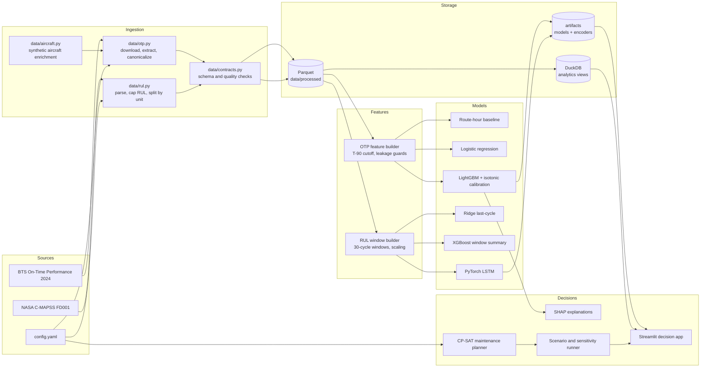

# Architecture

## 1. Design intent

FlightOps Insight is a **local decision-support prototype**. It is intentionally
split into four independently runnable stages so each can be replaced by a managed
service in production without rewriting the decision layer:

1. **Ingest** public data and normalize it into a canonical schema.
2. **Build features** with explicit leakage guards and a documented prediction cutoff.
3. **Train and evaluate** OTP and RUL models, then persist artifacts and metrics.
4. **Decide** through a CP-SAT maintenance plan and a Streamlit app.

The prototype runs on one machine. The production mapping in
[production_mapping.md](production_mapping.md) shows how each stage maps to Vertex AI,
Databricks and an approved airline data platform.

## 2. Logical architecture



## 3. Runtime sequence

### OTP batch training (daily or weekly)

```
BTS zips -> canonical flights -> time split (Jan-Aug / Sep-Oct / Nov-Dec)
         -> train route-hour rates on train only
         -> train logistic and LightGBM
         -> calibrate on validation only
         -> choose operating threshold on validation
         -> evaluate once on test
         -> SHAP sample + figures + metrics JSON
         -> Parquet predictions for the app
```

### OTP online scoring (T-90 minutes)

```
flight + schedule + inbound status known by cutoff
  -> feature builder (same code as training, no post-flight fields)
  -> LightGBM booster
  -> isotonic calibrator
  -> probability + risk tier
  -> local SHAP contributions
  -> OCC recommendation
```

The cutoff is enforced by `inbound_known`. If the inbound aircraft has not arrived
90 minutes before departure, actual inbound delay is set missing and the model uses
schedule, route, carrier, season and congestion features. Post-flight delay-cause
fields are never model inputs.

### RUL batch scoring (weekly per engine)

```
sensor history -> last 30 cycles -> scale with training scaler
              -> XGBoost / LSTM prediction (capped 0-125)
              -> conformal interval
              -> risk tier + recommended action
              -> CAMO watchlist
```

RUL is evaluated per engine unit, never per row. The 80/20 split is by unit.

### Maintenance planning (daily or on disruption)

```
fleet due list + hangar slots + cost policy
  -> build CP-SAT instance
  -> hard constraints (capacity, eligibility, check type, ground time, horizon)
  -> minimize disruption + early waste + AOG risk + unassigned penalty
  -> validate plan against the same constraints
  -> scenario and sensitivity runs
  -> planner approval / override
```

## 4. Component responsibilities

| Component | Responsibility | Key files |
|---|---|---|
| Configuration | Single source of truth for thresholds, costs, paths, seeds | `config.yaml`, `src/flightops/config.py` |
| Contracts | Canonical schema, required columns, quality checks | `src/flightops/data/contracts.py` |
| OTP ingestion | BTS download/extract, canonical columns, synthetic fallback | `src/flightops/data/otp.py` |
| RUL ingestion | C-MAPSS parse, cap, unit split | `src/flightops/data/rul.py` |
| Storage | Parquet for row-level data, DuckDB for analytics | `src/flightops/data/database.py` |
| OTP features | Leakage-safe transforms, categorical encoders | `src/flightops/features/otp_features.py` |
| RUL features | Window generation, scaling | `src/flightops/features/rul_features.py` |
| OTP models | Training, calibration, threshold selection, SHAP | `src/flightops/models/otp_model.py` |
| OTP serving | Load artifacts, predict, local explanation | `src/flightops/models/otp_predict.py` |
| RUL models | Ridge/XGBoost/LSTM, conformal, alert cost | `src/flightops/models/rul_model.py` |
| Optimization | Instance generation, CP-SAT model, validation | `src/flightops/optimization/` |
| Analytics | EDA, RCA narrative, figures | `src/flightops/analysis/otp_insights.py` |
| Live tracking | OpenSky ADS-B fetch, parsing, filters, demo fallback | `src/flightops/live/tracking.py` |
| App | Six decision pages and shared data access | `src/flightops/app/` |

## 5. Deployment topology (target, not implemented)

The recommended production split is:

- **Data and feature engineering:** Databricks with Unity Catalog and Delta Lake.
- **Model training and serving:** Vertex AI Pipelines, Model Registry and Endpoints.
- **Orchestration:** Cloud Composer or Databricks Workflows, triggered by data arrival.
- **Decision app:** containerized Streamlit or a thin internal web app behind SSO.
- **Governance:** model registry approvals, lineage, drift monitors, audit logs and
  human sign-off for maintenance actions.

This split is a recommendation, not a claim that the prototype is deployed. See
[production_mapping.md](production_mapping.md) for the component-by-component mapping.

## 6. Non-functional requirements for production

| Concern | Prototype | Production expectation |
|---|---|---|
| Latency | Batch training; app scores one flight in memory | <300 ms p95 online OTP score; batch RUL within the weekly window |
| Availability | Local machine | Multi-zone serving, health checks, graceful degradation |
| Security | No credentials in repo | SSO, least-privilege IAM, VPC-SC, CMEK, secret manager |
| Privacy | Public data only | PII minimization; crew/passenger data excluded |
| Audit | Logs and metrics JSON | Immutable model/version lineage and decision audit trail |
| Monitoring | Static metrics | Drift, calibration, data quality, alert and override rates |
| Rollback | Re-run scripts | Registry rollback to last approved model version |
| Testing | Unit tests + app smoke test | CI, integration tests, shadow mode, canary |
