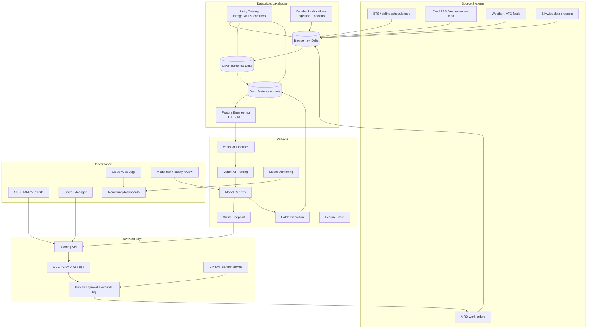

# Production mapping: Vertex AI, Databricks and Skywise governance

## 1. Purpose

This document maps the local prototype to a production architecture. It is a
**deployment plan**, not evidence that the prototype is deployed. There is no access
to Airbus Skywise, airline systems or airline data in this repository.

The recommended pattern is a split platform:

- **Databricks + Unity Catalog** for governed data engineering, feature backfills,
  lakehouse analytics and batch scoring.
- **Vertex AI** for pipeline orchestration, model registry, online endpoints, batch
  prediction and model monitoring.
- **Airline identity, network and security** for access control, secrets and audit.
- **Skywise or an approved airline data product** as a governed source/sink, only
  through an approved integration agreement.

This split is deliberately vendor-realistic: data gravity stays in the lakehouse,
while model serving and monitoring use a managed ML platform.

## 2. Target architecture



## 3. Component mapping

| Prototype component | Production (Vertex AI) | Production (Databricks) | Notes |
|---|---|---|---|
| `data/otp.py` BTS ingestion | Vertex AI Pipeline ingest step or Cloud Run job | Databricks Workflow / Auto Loader | Prefer Auto Loader for incremental files; keep raw immutable in Bronze. |
| `data/rul.py` C-MAPSS ingestion | Same | Auto Loader + Delta | Sensor feed may arrive via Kafka/Event Hubs in production. |
| `data/contracts.py` | Great Expectations / Dataplex checks in pipeline | Delta Live Tables expectations + Unity Catalog | Fail the pipeline on contract violations. |
| Parquet processed data | Cloud Storage + BigQuery external tables | Delta Lake Silver/Gold | One source of truth; avoid dual writes. |
| `features/otp_features.py` | Vertex AI custom training component | Databricks feature engineering notebook/job | Share a versioned feature library; prevent train/serve skew. |
| `features/rul_features.py` | Vertex AI custom training component | Databricks job | Windowed features are batch; online RUL scoring is weekly. |
| `models/otp_model.py` | Vertex AI Training custom container | MLflow experiment + model signature | Log params, metrics, datasets and SHAP artifacts. |
| `models/rul_model.py` | Vertex AI Training (CPU/GPU) | MLflow + TorchDistributor | LSTM can use GPU; XGBoost CPU is sufficient. |
| Model artifacts | Vertex AI Model Registry | MLflow Model Registry / Unity Catalog models | One registry should be authoritative; mirror metadata only. |
| `otp_predict.py` | Vertex AI Endpoint custom prediction routine | Databricks Model Serving | Online OTP scoring at T-90. |
| Batch scoring | Vertex AI Batch Prediction | Databricks batch inference | RUL weekly; OTP daily/hourly. |
| `maintenance_planner.py` | Cloud Run / GKE service with OR-Tools | Databricks job or container | CP-SAT is CPU-bound; keep it stateless. |
| `scenarios.py` | Vertex AI Pipeline scenario step | Databricks Workflow | Persist scenario results to Gold. |
| Streamlit app | Cloud Run behind IAP / SSO | Databricks App | Do not expose publicly. |
| Metrics JSON / figures | Cloud Storage + BigQuery | Delta Gold + dashboards | Feed both operations and model monitoring. |
| Logs | Cloud Logging | Databricks cluster logs + Unity Catalog audit | Correlate by request and model version. |

## 4. Vertex AI deployment plan

### 4.1 Project and environment layout

Use separate GCP projects (or at least separate buckets/datasets) for:

- `flightops-dev`
- `flightops-staging`
- `flightops-prod`

Enable:

- Vertex AI API
- Cloud Storage
- BigQuery
- Artifact Registry
- Cloud Run
- Cloud Build
- Cloud KMS
- Secret Manager
- Cloud Logging / Monitoring
- VPC Service Controls
- IAM / Workforce Identity Federation

### 4.2 Data and features

1. Land raw files in `gs://flightops-{env}-raw/`.
2. Build canonical tables in BigQuery or Databricks Delta.
3. Materialize OTP features into Vertex AI Feature Store or a versioned BigQuery
   table. For a T-90 online score, the feature vector is small; a direct feature
   lookup plus request payload is simpler than a full feature store.
4. Materialize RUL windows as a batch table; RUL is scored weekly, not per request.
5. Register feature definitions and data contracts in a metadata store.

### 4.3 Training pipeline

A Vertex AI Pipeline (KFP) with these components:

1. `validate_contracts`
2. `build_otp_features`
3. `train_otp_baselines`
4. `train_otp_lightgbm`
5. `calibrate_otp`
6. `evaluate_otp` (time-based test)
7. `explain_otp` (SHAP sample)
8. `build_rul_windows`
9. `train_rul_models`
10. `evaluate_rul` (RMSE, NASA score, conformal coverage)
11. `evaluate_alert_policy`
12. `register_models` (only if gates pass)

Pipeline parameters mirror `config.yaml`: seed, split months, cutoff, thresholds,
cost assumptions, LGBM/XGBoost/LSTM hyper-parameters, conformal alpha.

**Promotion gates:**

- OTP ROC-AUC and PR-AUC above the current production model on the same time window;
- calibration ECE below a agreed threshold (e.g. 0.03);
- no material regression on top-decile precision or flag rate;
- RUL RMSE and late-prediction rate within tolerance;
- conformal coverage within a band around the target;
- fairness/segment review signed off;
- model card and data card updated.

### 4.4 Model registry

Register:

- model artifact and container image digest;
- training data snapshot/version;
- feature list and encoder version;
- metrics and evaluation window;
- SHAP summary;
- model card version;
- approval status and approver.

Use aliases such as `staging`, `canary`, `production`, `retired`. Never overwrite a
production version in place.

### 4.5 Online OTP endpoint

Deploy a custom prediction routine or a FastAPI container to a Vertex AI Endpoint:

```
POST /predict
{
  "flight_id": "...",
  "carrier": "WN",
  "origin": "ATL",
  "dest": "DEN",
  "scheduled_departure": "2026-11-15T17:30:00",
  "sched_turn_min": 45,
  "inbound_known": true,
  "inbound_arr_delay_min": 12,
  ...
}
```

Response:

```
{
  "probability": 0.42,
  "risk_tier": "Moderate",
  "threshold": 0.3031,
  "top_drivers": [...],
  "model_version": "otp-2026-11-01",
  "scored_at": "..."
}
```

Requirements:

- p95 latency <300 ms excluding network;
- request validation and schema versioning;
- timeout and fallback to a rule-based baseline;
- no PII in logs;
- per-airline rate limits;
- canary 5% -> 25% -> 100% traffic;
- shadow mode before canary.

### 4.6 Batch RUL and maintenance planning

- RUL: Vertex AI Batch Prediction weekly, output to BigQuery/Delta, then a watchlist
  table for CAMO.
- Optimization: Cloud Run job triggered after the RUL watchlist refresh. Inputs are
  the due list and hangar slots; outputs are a proposed plan and scenario results.
- Planner approval: write the approved plan to the MRO system through an approved API,
  with the model version and approver recorded.

### 4.7 Monitoring

Vertex AI Model Monitoring plus custom dashboards:

- prediction drift (PSI/KL) on key features;
- calibration drift;
- label delay handling (OTP labels arrive after the flight; RUL labels after removal);
- alert rate, override rate, intervention rate;
- endpoint latency, error rate, saturation;
- data freshness and contract failures;
- cost per 1,000 scores.

## 5. Databricks deployment plan

### 5.1 Lakehouse layers

- **Bronze:** raw BTS/C-MAPSS/airline files, immutable, with ingestion metadata.
- **Silver:** canonical flight and sensor tables, deduplicated and contract-checked.
- **Gold:** OTP features, RUL windows, model outputs, watchlists, optimization
  results and BI marts.

Use Unity Catalog for catalogs, schemas, tables, volumes, models and lineage.

### 5.2 Workflows

| Job | Schedule | Output |
|---|---|---|
| `ingest_bts` | Monthly / on arrival | Bronze flights |
| `build_flights` | Daily | Silver flights |
| `build_otp_features` | Daily | Gold OTP features |
| `train_otp` | Weekly / monthly | MLflow run + model |
| `score_otp` | Hourly / on demand | Gold OTP scores |
| `ingest_cmapss` | Weekly | Bronze sensor |
| `build_rul_windows` | Weekly | Gold RUL windows |
| `train_rul` | Monthly / on new labels | MLflow run + model |
| `score_rul` | Weekly | Gold RUL watchlist |
| `optimize_maintenance` | Daily / on disruption | Gold maintenance plan |
| `monitor_models` | Daily | Drift and performance tables |

### 5.3 MLflow

Log:

- params from `config.yaml`;
- metrics (ROC-AUC, PR-AUC, Brier, ECE, RMSE, NASA score, coverage);
- artifacts (model, encoders, SHAP, figures, model card);
- dataset fingerprint and split definition;
- git commit and container image;
- signature and input example.

Register models in Unity Catalog or MLflow Model Registry. Use aliases for promotion.

### 5.4 Serving choice

- **Databricks Model Serving** is a good fit if the airline standardizes on
  Databricks and wants the model next to the lakehouse.
- **Vertex AI Endpoint** is a good fit if the airline wants a managed Google serving
  plane, or already uses Vertex for other models.
- Do not run both in production for the same decision unless one is a documented
  fallback.

## 6. Skywise and airline data governance

There is **no Skywise access** in this prototype. A production integration would
require an approved data-sharing agreement and the airline's own governance.

### 6.1 Integration principles

- Treat Skywise as a governed **data product**, not a database to scrape.
- Use approved APIs/exports and the airline's data contract.
- Do not copy restricted data into a personal or prototype environment.
- Minimize data: only the fields needed for the decision.
- Record lineage from source product to model feature to decision.
- Respect retention, export-control and cross-border requirements.

### 6.2 Governance controls

| Control | Expectation |
|---|---|
| Data ownership | Named data owner and steward for each product. |
| Access | SSO, least privilege, need-to-know, periodic review. |
| Classification | Public / internal / confidential / restricted labels. |
| Lineage | End-to-end from source to model to decision. |
| Quality | Contract tests, freshness SLAs, reconciliation. |
| Audit | Immutable logs of access, scoring and overrides. |
| Model risk | Independent validation, approval and periodic review. |
| Safety | Licensed engineer sign-off for maintenance decisions. |
| Retention | Defined retention and deletion schedule. |
| Incident | Documented response and rollback. |

### 6.3 Human-in-the-loop

**OTP:**

- The model ranks flights; the OCC decides.
- Every intervention and override is logged with a reason.
- No automatic passenger communication.
- A duty manager can ignore the model without penalty.

**RUL:**

- The model produces a watchlist and a recommended action.
- A licensed engineer reviews the evidence (sensor trend, borescope, oil analysis,
  OEM limits).
- Any removal, deferral or continued-operation decision is signed off under the
  approved maintenance programme.
- The model never writes directly to a release-to-service record.

**Optimization:**

- The planner reviews the proposed schedule.
- Any aircraft scheduled past its due date requires an explicit engineering review.
- Unassigned aircraft trigger an escalation, not a silent deferral.
- Overrides and reasons are fed back to model monitoring.

## 7. CI/CD and infrastructure as code

Recommended:

- Terraform for GCP projects, buckets, IAM, Vertex AI endpoints, Cloud Run, VPC-SC.
- Databricks Asset Bundles for jobs, notebooks, pipelines and permissions.
- GitHub Actions or Cloud Build for:
  - lint, type check, unit tests;
  - container build and vulnerability scan;
  - pipeline compile and validation;
  - staging deployment;
  - integration and smoke tests;
  - manual approval for production.

Promotion flow:

```
feature branch -> CI -> staging -> shadow -> canary 5% -> 25% -> 100% -> production
```

Rollback:

- Vertex AI: shift traffic back to the previous endpoint version.
- Databricks: restore the previous model alias and job version.
- Keep the last known-good feature table and model artifact immutable.

## 8. Security architecture

- SSO via the airline identity provider; no local passwords.
- Service accounts with least privilege; no user-owned long-lived keys.
- Secret Manager for API keys and database credentials.
- Private networking / Private Service Connect; no public buckets.
- VPC Service Controls around Vertex AI, BigQuery and Cloud Storage.
- CMEK for data at rest.
- TLS in transit.
- Request signing and replay protection for scoring APIs.
- Input validation and rate limiting.
- PII minimization; no passenger or crew data in the prototype.
- Audit logs exported to a SIEM.
- Dependency scanning and signed container images.
- Separate dev/staging/prod projects and data.

## 9. Monitoring and model risk

### 9.1 OTP

- ROC-AUC, PR-AUC, Brier, ECE on rolling labelled windows.
- Top-decile precision, capture and flag rate.
- Calibration by carrier, station, route and time of day.
- `inbound_known` rate and missingness.
- OCC override and intervention rates.
- Late-label arrival and backfill completeness.

### 9.2 RUL

- RMSE, MAE, NASA score and late-prediction rate on labelled removals.
- Conformal coverage and interval width.
- Alert precision, recall and time-to-shop.
- Unscheduled removal and AOG rates.
- Sensor drift and missing channels.
- CAMO override rate and reasons.

### 9.3 Optimization

- Solver status and solve time.
- Unassigned count and escalation rate.
- Lateness days and AOG exposure.
- Early-maintenance waste.
- Planner override rate.
- Actual versus planned check duration.

### 9.4 Model risk

- Independent validation before first production use.
- Annual or event-driven review.
- Documented model inventory and ownership.
- Defined risk appetite for false negatives and false positives.
- Change control for features, thresholds and cost assumptions.
- Incident review for missed critical events.

## 10. Rollout plan

| Phase | Duration | Exit criteria |
|---|---|---|
| 0. Prototype | Done | Reproducible metrics, app, tests, docs. |
| 1. Data access | 4-8 weeks | Approved data contract, security review, data landing. |
| 2. Rebuild on airline data | 4-6 weeks | Contracts pass, features reproduced, model retrained. |
| 3. Shadow mode | 8-12 weeks | No operational dependency; compare to current practice. |
| 4. Controlled pilot | 8-12 weeks | OCC/CAMO users, override logging, guardrails, training. |
| 5. Production | Ongoing | SLOs, monitoring, on-call, model-risk approval, rollback tested. |

Do not skip shadow mode. Public-data metrics are not evidence of airline performance.

## 11. Cost and capacity considerations

- Vertex AI training is intermittent; use preemptible/spot where safe.
- Online OTP scoring is small; the dominant cost is the endpoint uptime and
  observability, not compute.
- RUL batch scoring is weekly; a CPU instance is sufficient for C-MAPSS-scale data.
- CP-SAT is CPU-bound and short; Cloud Run with a modest CPU limit is enough for the
  15-aircraft instance. A real fleet may need a larger instance and a longer time
  limit.
- Databricks cost is driven by cluster uptime and data scanning; use partitioned Delta
  tables and cluster policies.
- Store only needed columns in Gold; keep raw data in cheap object storage.

## 12. What is intentionally not included

- No real airline credentials, endpoints or data.
- No Skywise API calls.
- No production Terraform or Databricks bundle that would create billable resources.
- No claim that the prototype passes airline security, safety or model-risk review.
- No automatic release-to-service or flight-decision path.

The deployment assets in `deployment/` are **templates and runbooks**, not a live
deployment.
